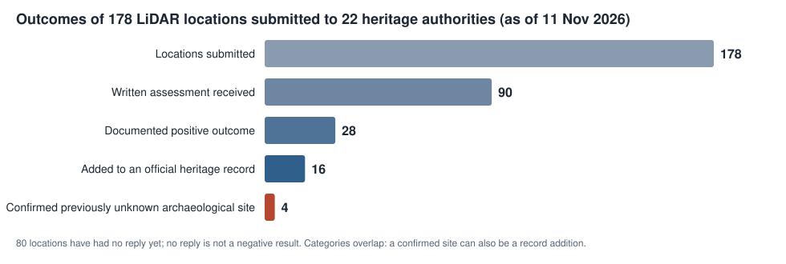

# LiDAR archaeology: independently assessed outcomes

This repository is the public record of what an AI-assisted LiDAR survey has found so far, as judged by the
archaeologists responsible for each area. Each location was submitted to the heritage authority for that area, and
this page reports what they said, including the cases where they said no.

**As of 11 November 2026:**

| | Count |
|---|---|
| Locations submitted to heritage authorities | **178**, to 22 authorities in 5 countries |
| Locations with a written assessment so far | **90** (80 have had no reply yet; 8 acknowledged or pending) |
| **Previously unknown archaeological sites, confirmed by the responsible archaeologist** | **4** (three burial mounds and one barrow field, Lower Saxony, Germany; one already has an official site number) |
| Previously unknown probable site, inspected on the ground, not yet confirmed | 1 |
| Completed additions to official heritage records | 16 (one of them is a confirmed site above) |
| All documented positive outcomes | 28 |

The four confirmed sites are the headline result. They are listed in [`discoveries/`](discoveries/). Everything else,
including record additions that turned out to be modern, is in the [catalogue](CONTENTS.md). Machine-readable versions
are in [`status.json`](status.json) and [`data/outcomes.csv`](data/outcomes.csv).

## What "confirmed" means here

A site counts as a confirmed discovery only when the archaeologist responsible for that area states in writing that it
is (a) archaeological and (b) previously unknown to their records. Their judgment is the test. Our own model reviews,
an absence from a public map, or a record addition do not count. The full rules are in
[VERIFICATION.md](VERIFICATION.md).

None of the four has been excavated or dated, and no field visit has been reported for them. They were assessed from
the desk, using the LiDAR views we supplied together with the authority's own records. One has been given an official
site number. These are assessments by qualified people, not excavation results, and we describe them that way.

## How the results were produced

1. **Terrain.** Public LiDAR terrain models (in Lower Saxony, LGLN DGM1, CC BY 4.0; in England, the Environment
   Agency composite DTM; in France, the IGN LiDAR HD terrain model).
2. **Detection.** Neural detectors adapted from the public ADAF archaeological detector, trained and tested on
   registered monuments. The weights of the detectors that found the four confirmed sites are public (Zenodo
   [10.5281/zenodo.23862470](https://doi.org/10.5281/zenodo.23862470)). The measured performance of these detectors,
   with frozen protocols, is in two preprints ([10.5281/zenodo.23352619](https://doi.org/10.5281/zenodo.23352619),
   [10.5281/zenodo.23874293](https://doi.org/10.5281/zenodo.23874293)) and the code repository
   [ndsbarrow-adapt](https://github.com/tee-20190/ndsbarrow-adapt).
3. **Screening.** Detections that matched a public monument register were set aside. Language-model readers then
   reviewed terrain images of the remainder, in most batches without being told which detector proposed them, and
   only the locations they kept were considered for submission.
4. **Assessment.** Small batches were sent to the responsible heritage authority by the project owner. Each
   authority compared the locations with its own records, which are more complete than any public map. Some also
   looked at historical imagery or visited the site.

The engineering and analysis were carried out by AI agents (Anthropic Claude models and OpenAI Codex) working in one
project repository under the owner's direction. People made the archaeological judgments.

## Scale

All of this was done by one person working with AI agents, using only public terrain data, public detector weights
and ordinary email, in about two months from the first submission (10 September 2026) to this release. The detectors and
weights are public. The bottleneck is not finding candidates but the time of the archaeologists who assess them; the
point of this record is to show what a single person can responsibly put in front of them, and what comes back. [METHOD.md](METHOD.md) has
the details and what each step does and does not show.

## What this does not show

- **It is not a precision estimate.** The submitted locations were selected, batches differ by region and detector,
  and 80 locations still have no reply. Unanswered is not negative. Of the 90 assessed, 14 were already recorded, 30
  were judged modern, natural, landscaping or otherwise not archaeological, and 18 remain undetermined
  ([FUNNEL.md](FUNNEL.md)).
- **"Not on the public map" does not mean "unknown".** Several authorities hold far more than they publish. One
  Lower Saxony authority found that of 11 places that were blank on the public atlas, 6 were already known to them.
  This is why every claim in this repository rests on the authority's own check.
- **No dates or functions are claimed.** "Burial mound" is the assessing archaeologist's interpretation of the form.

## How to verify every claim

Each confirmed site has its own page with:

- the **name and role of the archaeologist** who assessed it, and their authority;
- their **written reply, verbatim in German**, with an English translation;
- the **label under which we submitted it**, so the authority can be asked about that exact item;
- the **official site number**, where one has been issued (D04: Liebenau-Binnen FStNr. 13);
- a **150 m LiDAR hillshade** of the mound, made from public terrain data anyone can download;
- a **SHA-256 commitment** to the exact submitted coordinates (next section);
- **everything we looked at** before submitting it, in its `evidence/` folder.

The authorities' contact details are on their public websites. They, not we, are the source of truth.

## All the evidence we looked at

Every one of the 28 outcomes has an `evidence/` folder with the material the project itself used, not only what the
authority was sent:

- **Lower Saxony (D01 to D04, P01, R14, R15):** the full internal evidence card. DGM1 LiDAR hillshade at 150 m and
  500 m, a local relief model, every LGLN orthophoto flight from 2014 to 2025 (colour and colour-infrared), the
  first-edition Messtischblatt of 1897 to 1900, the detector's output (model, probability, size, roundness, distance to
  the nearest registered mound), the model reader's structured review with its reading of each image and the
  non-archaeological explanation it tested, and the sheet or list actually sent to the archaeologist.
- **England and France (R01 to R13, O01 to O08):** the images sent with each enquiry and, where one was written, the
  internal research dossier and its adversarial challenge, with their terrain measurements, profiles, historic maps
  and orthophotos from 1950 onward.

Coordinates, grid references, coordinate query links, internal file paths and map-tile indices are removed from every
file. Nothing else is edited. A few dossier files are not included: third-party scans whose reuse terms do not allow
republication (archive cadastre sheets, book and journal pages, Esri and NLS imagery). Each folder lists what it
leaves out.

## Why exact coordinates are not published

The location of every site is given to municipality level, as the official Lower Saxony find chronicle (Fundchronik)
does. The exact coordinates are withheld. These are unprotected burial mounds in fields and woodland, and illegal
digging and metal detecting at newly publicised sites is a real and recurring problem. Their exact positions are held by
the responsible authorities, which can share them with researchers.

So that the submitted points can still be proven later, each site page carries a SHA-256 hash of the exact submitted
coordinates plus a random salt. When the coordinates are released, the salted string can be checked against the hash.

The context imagery in the `evidence/` folders (500 m terrain views, orthophotos, historic maps) is published so the
assessments can be checked. It does not give coordinates, but someone determined could use it to find a site. All of
these mounds are protected under the monument protection laws of their states and countries. Digging or detecting at
them is an offence.

## Contents

| Path | Content |
|---|---|
| [`CONTENTS.md`](CONTENTS.md) | Catalogue of all 28 positive outcomes, by tier |
| [`discoveries/`](discoveries/) | One page for each confirmed site, plus the field-inspected probable site: assessor, verbatim reply, field photo (P01), all evidence we looked at, coordinate commitment |
| [`records/`](records/) | R01 to R15, the record additions: what was sent, internal dossiers and evidence cards |
| [`other-outcomes/`](other-outcomes/) | O01 to O08: what was sent and internal dossiers |
| [`FUNNEL.md`](FUNNEL.md) | Every outcome of the 178 submissions, negatives included |
| [`VERIFICATION.md`](VERIFICATION.md) | Tier definitions and counting rules |
| [`METHOD.md`](METHOD.md) | Data, detectors, screening and assessment |
| [`status.json`](status.json), [`data/outcomes.csv`](data/outcomes.csv) | Machine-readable records |
| [`history.md`](history.md) | Versions and corrections |

## Versions and corrections

This is a live record. When an authority revises an assessment, the change is recorded in [history.md](history.md) and
earlier versions stay in the Git history. One correction is already recorded: a Hertfordshire mound added to the
record turned out, on our own later check of dated surveys, to have formed between 2003 and 2009.

## Credit

The archaeological assessments belong to the heritage authorities listed in [CONTENTS.md](CONTENTS.md). Terrain data:
LGLN (CC BY 4.0), Environment Agency (Open Government Licence), IGN (Licence Ouverte 2.0). Orthophotos: LGLN DOP20
(CC BY 4.0), IGN. Historic maps: SLUB Dresden / Deutsche Fotothek (Messtischblatt), IGN, BnF Gallica. The detectors build on ADAF (Apache-2.0 code,
CC BY-SA 4.0 weights). Register data: Denkmalatlas Niedersachsen (CC BY-SA 4.0), Historic Environment Records.

Contact: open an issue in this repository.

## Licence

Text and data in this repository: [CC BY 4.0](LICENSE). Cite with [CITATION.cff](CITATION.cff).
