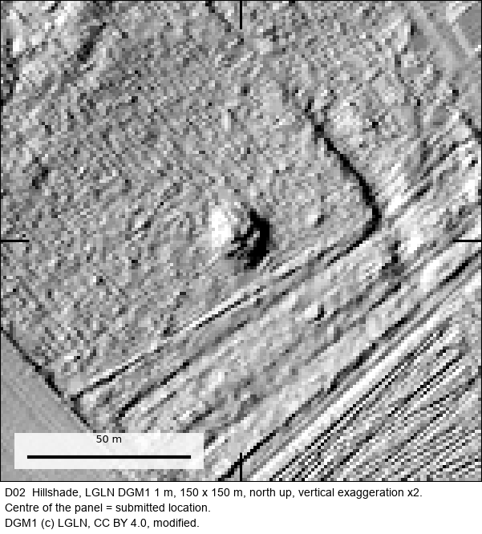
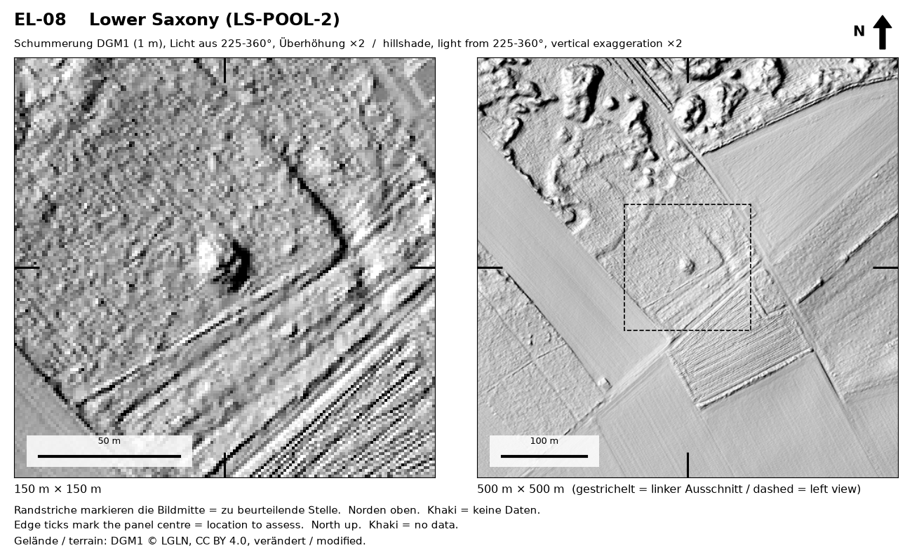
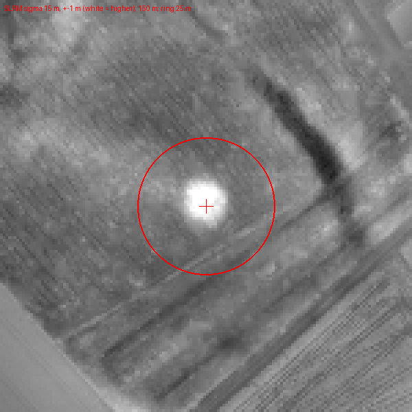
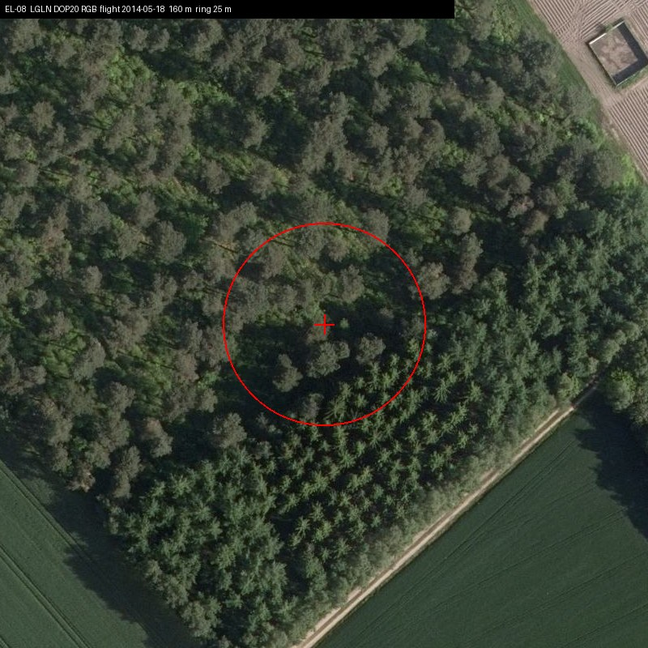
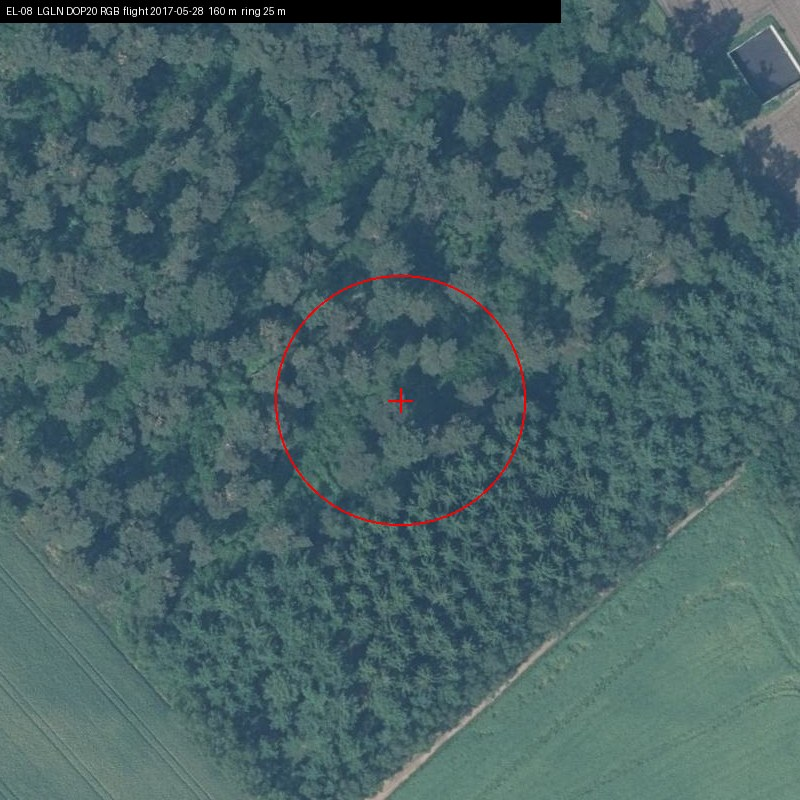
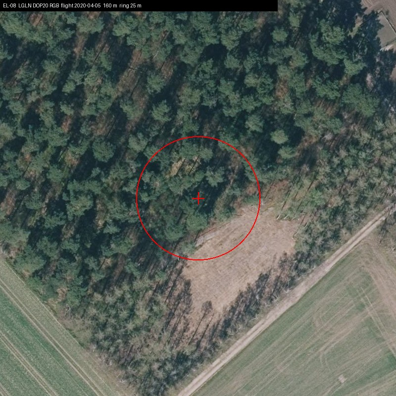
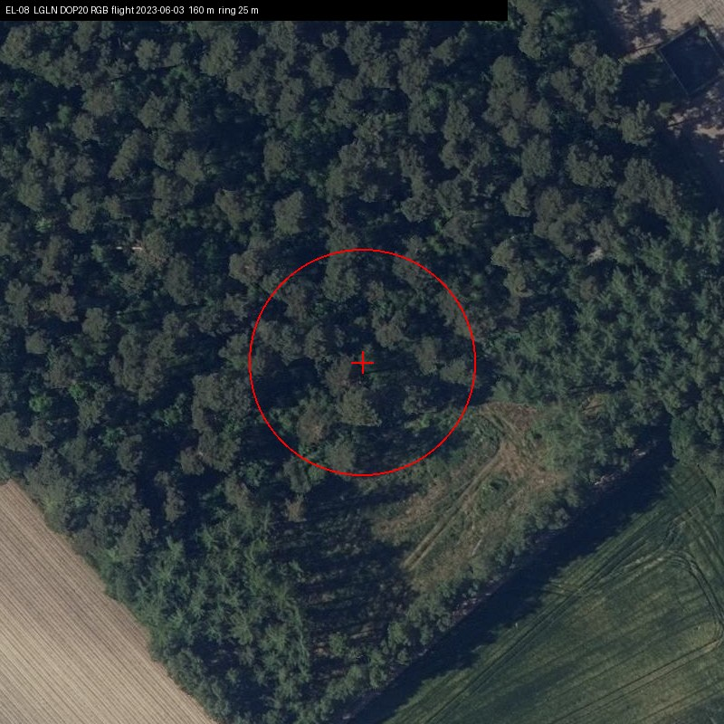
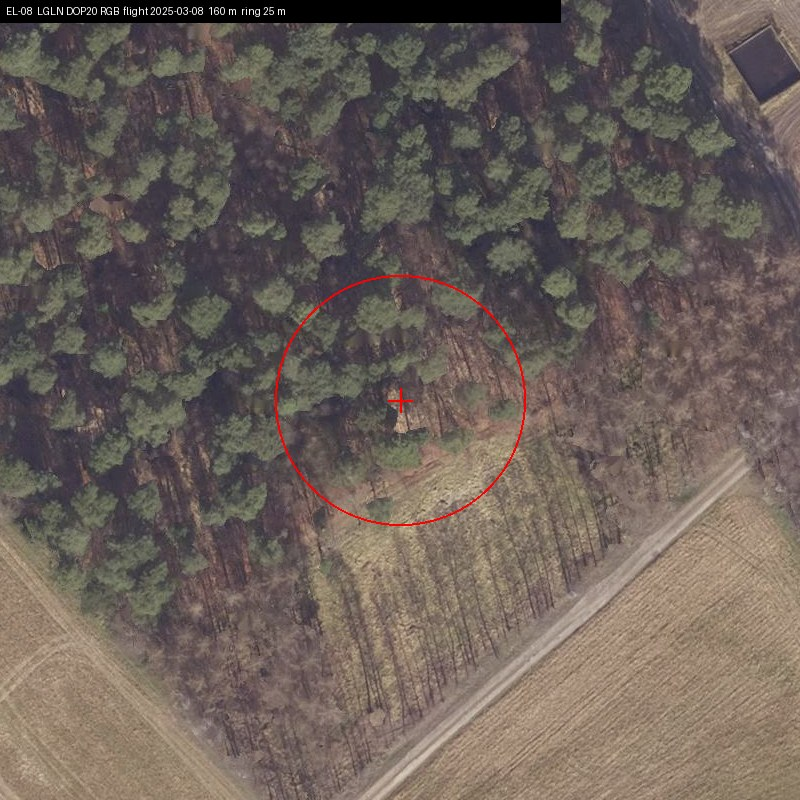
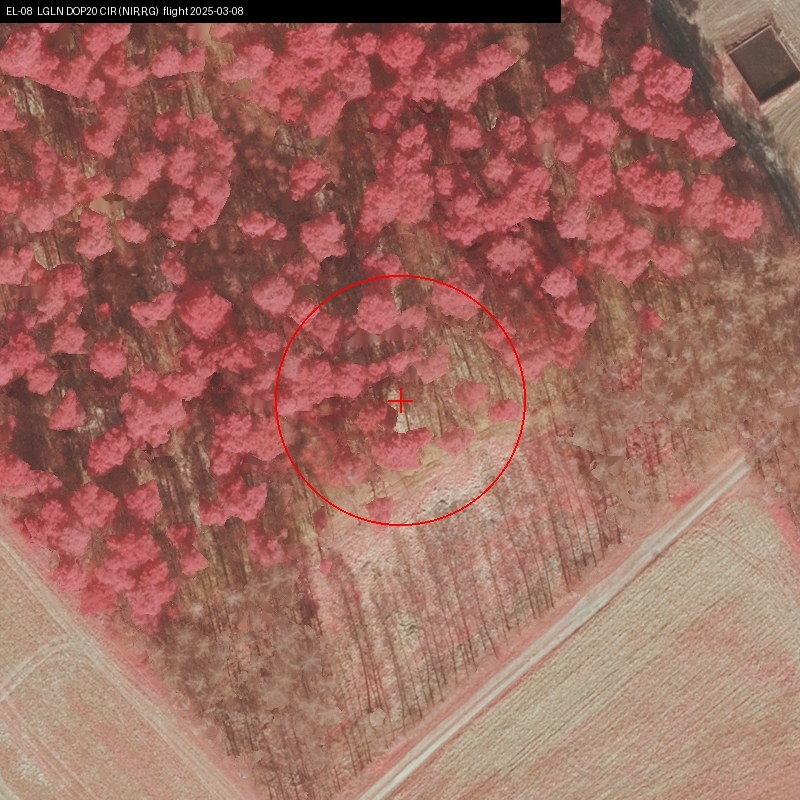
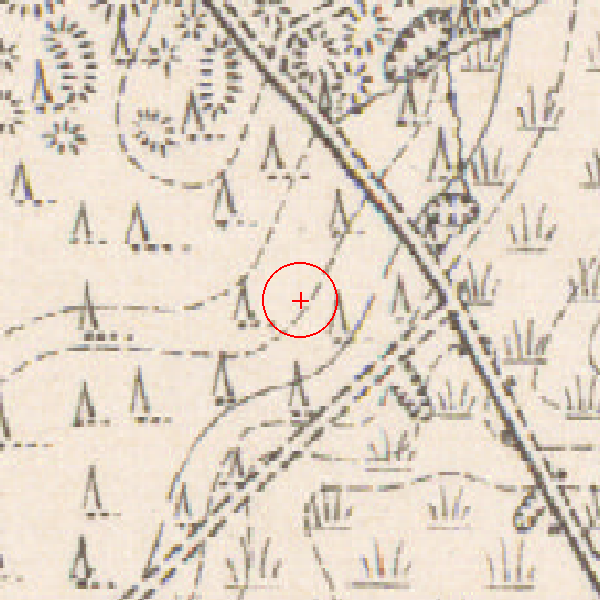

# D02: Burial mound, Gemeinde Lähden, Landkreis Emsland

| | |
|---|---|
| Status | **Confirmed: previously unknown archaeological site** |
| Location | Gemeinde Lähden, Landkreis Emsland, Lower Saxony (municipality level; exact coordinates withheld, see below) |
| Feature | Burial mound |
| Assessed by | **Thomas Kassens, Kreisarchäologe (district archaeologist)**, Kreisarchäologie Landkreis Emsland (district archaeology service) |
| Written assessment | 2026-10-29 |
| Label in the submission | `EL-10` |
| Official record | none reported |
| Detector | D1 |
| Terrain | LGLN DGM1, 1 m (CC BY 4.0) |
| Coordinate commitment (SHA-256) | `6c03703aa3f7a40666bc8a1cb651ff68eefe71f720577d53e6c4c099a551beda` |

## How it was found

Proposed by the D1 detector. The location was screened against the public Denkmalatlas Niedersachsen and reviewed by language-model readers
before it was submitted. The project owner then sent it to the responsible archaeologist with coordinates and LiDAR
views.

## The assessment, verbatim

The archaeologist's reply, as received. Contact details and the quoted earlier message are removed; `[…]` marks other
omissions and `[Fundstelle entfernt]` marks the names and numbers of already known sites, which are not ours to publish.

> Sehr geehrter Herr Shanahan,
>
> vielen Dank für die Daten. In einigen Fällen waren es tatsächlich bisher unbekannte Grabhügel.
>
> EL-01 Bekannt
> EL-02 Bekannt
> EL-03 kein Grabhügel
> EL-04 Bekannt
> EL-05 bekannt aber bisher Falsch Markiert
> EL-06 Bisher Unbekannt
> EL-07 Unsicher
> EL-08 Kein Grabhügel
> EL-09 Kein Grabhügel
> EL-10 Bisher Unbekannt
> EL-11 Bisher Unbekannt (Grabhügelfeld)
> EL-12 unsicherer Grabhügel
> EL-13 kein Grabhügel
> EL-14 bekannt aber bisher Falsch Markiert
> EL-15 Bekannt
>
> Mit freundlichem Gruß
> Im Auftrag
>
> Thomas Kassens
> (Kreisarchäologe)

**English translation (ours):**

> Dear Mr Shanahan,
>
> Thank you for the data. In some cases these were indeed previously unknown burial mounds.
>
> EL-01 known · EL-02 known · EL-03 not a burial mound · EL-04 known · EL-05 known but previously marked wrongly ·
> **EL-06 previously unknown** · EL-07 uncertain · EL-08 not a burial mound · EL-09 not a burial mound ·
> **EL-10 previously unknown** · **EL-11 previously unknown (barrow field)** · EL-12 uncertain burial mound ·
> EL-13 not a burial mound · EL-14 known but previously marked wrongly · EL-15 known
>
> Kind regards, Thomas Kassens (district archaeologist)

## Everything we looked at

The full internal evidence card is in [`evidence/`](evidence/) ([file list](evidence/README.md)): every image and
record the project used to decide whether to submit this location, plus what was sent to the authority.
Coordinates are removed; nothing else is edited.

**LiDAR terrain (LGLN DGM1, 1 m).** Hillshade at 150 m and 500 m, and a local relief model:

**Orthophotos (LGLN DOP20), every year available**, used to rule out modern heaps, buildings and earthworks:

| 2014-05-18 | 2017-05-28 | 2020-04-05 | 2023-06-03 | 2025-03-08 | 2025-03-08 |
|---|---|---|---|---|---|
|  |  |  |  |  |  |

**Historic map.** First-edition Messtischblatt (1900), checked for a mapped structure, pit or building at the point:

**The model reader's review before submission** (verbatim extracts from [`reader_review.json`](evidence/reader_review.json)):

> A discrete round mound about 12 m across and up to c. 1.6 m high, isolated in a ditch-bounded pine plot between arable fields. No modern object stands on it in five orthophoto flights 2014-2025; the 2025 flight shows only a pale patch on its face. The 1900 Messtischblatt shows woodland here with no monument or extraction symbol.

Open alternative it asked the archaeologist to weigh: *Could this be a spoil or clearance heap from digging the plot ditches or from building the nearby straight corridor, or a natural sand knoll from the dune area to the north, rather than a burial mound?*

**Detector output** ([`detection.json`](evidence/detection.json)): mean probability 0.960; area 476 m², roundness 0.95; nearest registered burial mound 2938 m away in the public register snapshot.

**What the authority received:** a coordinate list with diameter and prominence for each location (this row,
coordinates removed: [`submitted_row.json`](evidence/submitted_row.json)). No images were sent with this batch.

## What the assessment does and does not establish

Written confirmation by the district archaeologist that it is a previously unknown burial mound. No field visit, excavation, date or record number reported.

## The batch it came from

Emsland batch of 15 locations: 3 previously unknown (D01, D02, D03), 6 already known (2 of them previously marked in the wrong place), 4 not burial mounds, 2 uncertain.

## How to check this yourself

1. Ask the assessing authority, named above, about the label in the submission (`EL-10`)
   and the date of its assessment. Its contact details are on its public website.
2. Look at the terrain yourself: the hillshade above is made from public LGLN DGM1 data, which anyone can download.
3. The coordinate commitment is the SHA-256 of a string containing this ID, the exact submitted ETRS89/UTM32N
   coordinates and a random salt. The exact coordinates are withheld to protect the site (see the
   [README](../../README.md#why-exact-coordinates-are-not-published)). When they are released, to a researcher or
   publicly, the string can be published and checked against this hash, proving which point was submitted on which
   date.
