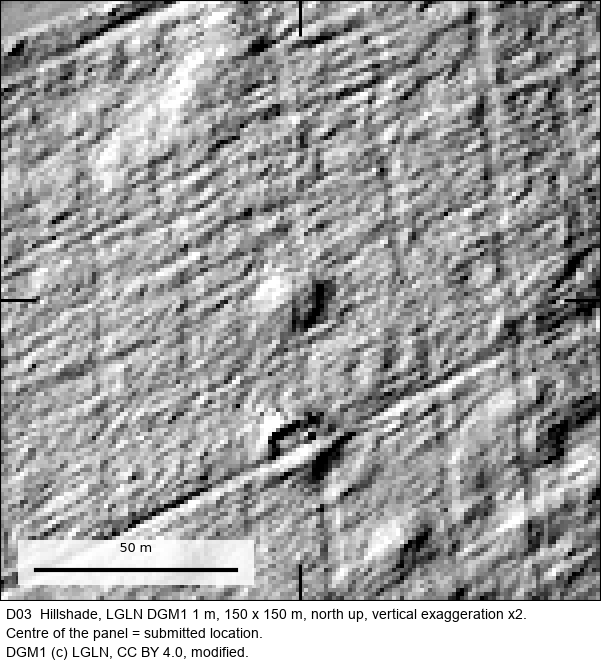

# D03: Barrow field, Gemeinde Groß Berßen, Landkreis Emsland

| | |
|---|---|
| Status | **Confirmed: previously unknown archaeological site** |
| Location | Gemeinde Groß Berßen, Landkreis Emsland, Lower Saxony (municipality level; exact coordinates withheld, see below) |
| Feature | Barrow field (several mounds; number not stated by the assessor) |
| Assessed by | **Thomas Kassens, Kreisarchäologe (district archaeologist)**, Kreisarchäologie Landkreis Emsland (district archaeology service) |
| Written assessment | 2026-10-29 |
| Label in the submission | `EL-11` |
| Official record | none reported |
| Detector | S_D + PROX |
| Terrain | LGLN DGM1, 1 m (CC BY 4.0) |
| Coordinate commitment (SHA-256) | `3b40323d000630d0d164068147d4124eb5315da180181824c1a18e2de42e8c58` |

## How it was found

Proposed by S_D + PROX. The assessor confirmed the field as previously unknown without stating how many mounds it contains, so it is counted once. The location was screened against the public Denkmalatlas Niedersachsen and reviewed by language-model readers
before it was submitted. The project owner then sent it to the responsible archaeologist with coordinates and LiDAR
views.

## The assessment, verbatim

The archaeologist's reply, as received. Contact details and the quoted earlier message are removed; `[…]` marks other
omissions and `[Fundstelle entfernt]` marks the names and numbers of already known sites, which are not ours to publish.

> Sehr geehrter Herr Shanahan,
>
> vielen Dank für die Daten. In einigen Fällen waren es tatsächlich bisher unbekannte Grabhügel.
>
> EL-01 Bekannt
> EL-02 Bekannt
> EL-03 kein Grabhügel
> EL-04 Bekannt
> EL-05 bekannt aber bisher Falsch Markiert
> EL-06 Bisher Unbekannt
> EL-07 Unsicher
> EL-08 Kein Grabhügel
> EL-09 Kein Grabhügel
> EL-10 Bisher Unbekannt
> EL-11 Bisher Unbekannt (Grabhügelfeld)
> EL-12 unsicherer Grabhügel
> EL-13 kein Grabhügel
> EL-14 bekannt aber bisher Falsch Markiert
> EL-15 Bekannt
>
> Mit freundlichem Gruß
> Im Auftrag
>
> Thomas Kassens
> (Kreisarchäologe)

**English translation (ours):**

> Dear Mr Shanahan,
>
> Thank you for the data. In some cases these were indeed previously unknown burial mounds.
>
> EL-01 known · EL-02 known · EL-03 not a burial mound · EL-04 known · EL-05 known but previously marked wrongly ·
> **EL-06 previously unknown** · EL-07 uncertain · EL-08 not a burial mound · EL-09 not a burial mound ·
> **EL-10 previously unknown** · **EL-11 previously unknown (barrow field)** · EL-12 uncertain burial mound ·
> EL-13 not a burial mound · EL-14 known but previously marked wrongly · EL-15 known
>
> Kind regards, Thomas Kassens (district archaeologist)

## What the assessment does and does not establish

Written confirmation by the district archaeologist that it is a previously unknown barrow field. Counted as one site. No field visit, excavation, date or record number reported.

## The batch it came from

Emsland batch of 15 locations: 3 previously unknown (D01, D02, D03), 6 already known (2 of them previously marked in the wrong place), 4 not burial mounds, 2 uncertain.

## How to check this yourself

1. Ask the assessing authority, named above, about the label in the submission (`EL-11`)
   and the date of its assessment. Its contact details are on its public website.
2. Look at the terrain yourself: the hillshade above is made from public LGLN DGM1 data, which anyone can download.
3. The coordinate commitment is the SHA-256 of a string containing this ID, the exact submitted ETRS89/UTM32N
   coordinates and a random salt. The exact coordinates are withheld to protect the site (see the
   [README](../../README.md#why-exact-coordinates-are-not-published)). When they are released, to a researcher or
   publicly, the string can be published and checked against this hash, proving which point was submitted on which
   date.
