# D04: Burial mound, Binnen (Liebenau), Landkreis Nienburg/Weser

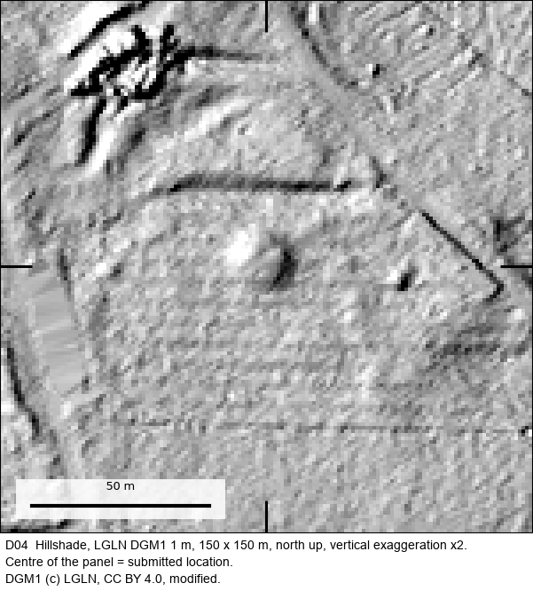

| | |
|---|---|
| Status | **Confirmed: previously unknown archaeological site** |
| Location | Binnen (Liebenau), Landkreis Nienburg/Weser, Lower Saxony (municipality level; exact coordinates withheld, see below) |
| Feature | Burial mound |
| Assessed by | **Dr Daniel Lau, Kommunalarchäologe (municipal archaeologist)**, Kommunalarchäologie Schaumburger Landschaft (municipal archaeology service) |
| Written assessment | 2026-11-02 (assessment), 2026-11-03 (site number) |
| Label in the submission | `SL-01` |
| Official record | Liebenau-Binnen FStNr. 13 |
| Detector | S_D + PROX |
| Terrain | LGLN DGM1, 1 m (CC BY 4.0) |
| Coordinate commitment (SHA-256) | `8538c2026d56695160248badda800c5a5a7533769f552f42e2b94f2c2819ad31` |

## How it was found

Proposed by S_D + PROX in a Lower Saxony screening pool. The location was screened against the public Denkmalatlas Niedersachsen and reviewed by language-model readers
before it was submitted. The project owner then sent it to the responsible archaeologist with coordinates and LiDAR
views.

## The assessment, verbatim

The archaeologist's reply, as received. Contact details and the quoted earlier message are removed; `[…]` marks other
omissions and `[Fundstelle entfernt]` marks the names and numbers of already known sites, which are not ours to publish.

> Sehr geehrter Herr Shanahan,
>
> vielen Dank für Ihre sehr wertvollen Informationen.
>
> SL 01 ist bislang gänzlich unbekannt gewesen! Ich werde dafür Ende der Woche eine neue Fundstellennummer generieren und den Hügel als Fundmeldung in die Fundchronik Niedersachsen 2026 aufnehmen. Vielen Dank für diese ausgezeichnete Entdeckung. […]
>
> SL 02 ist der bereits bekannte Grabhügel [Fundstelle entfernt] und wurde zuletzt im Februar 2024 aufgesucht […].
>
> SL 03 ist der bereits bekannte Grabhügel [Fundstelle entfernt] und wurde per LIDAR-Auswertung 2020 entdeckt […].
>
> SL 04 ist der bereits bekannte Grabhügel [Fundstelle entfernt] und wurde ebenfalls per LIDAR-Auswertung in 2020 entdeckt […].
>
> SL 05 und 06 wurden mir ebenfalls bereits gemeldet, dafür habe ich jedoch noch keine Fundstellennummern generiert, da die Datengrundlage der Meldung zu schlecht war. Aufgrund Ihrer Daten werde ich hier ebenfalls neue Fundstellennummern anlegen können und die Hügel in die Fundchronik aufnehmen.
>
> Eine großartige Arbeit!
>
> Herzliche Grüße aus Bückeburg
> Daniel Lau

**English translation (ours):**

> Thank you for your very valuable information. **SL 01 was previously completely unknown!** I will generate a new site
> number for it at the end of the week and include the mound as a find report in the Fundchronik Niedersachsen 2026.
> Thank you for this excellent discovery. […] SL 02, SL 03 and SL 04 are already known burial mounds (two of them were
> found by LiDAR analysis in 2020). SL 05 and 06 had also been reported to me, but I had not yet created site numbers
> because the data behind the report were too poor. On the basis of your data I can now create new site numbers for
> them too and include the mounds in the Fundchronik. Great work!

Follow-up the next day:

> SL-01 ist jetzt die Fundstelle Liebenau-Binnen FStNr. 13
> SL-05 = Hameln FStNr. 254
> SL-06 = Hameln FStNr. 255
> […]

> SL-01 is now the site Liebenau-Binnen FStNr. 13; SL-05 = Hameln FStNr. 254; SL-06 = Hameln FStNr. 255.

## Everything we looked at

The full internal evidence card is in [`evidence/`](evidence/) ([file list](evidence/README.md)): every image and
record the project used to decide whether to submit this location, plus what was sent to the authority.
Coordinates are removed; nothing else is edited.

**LiDAR terrain (LGLN DGM1, 1 m).** Hillshade at 150 m and 500 m, and a local relief model:

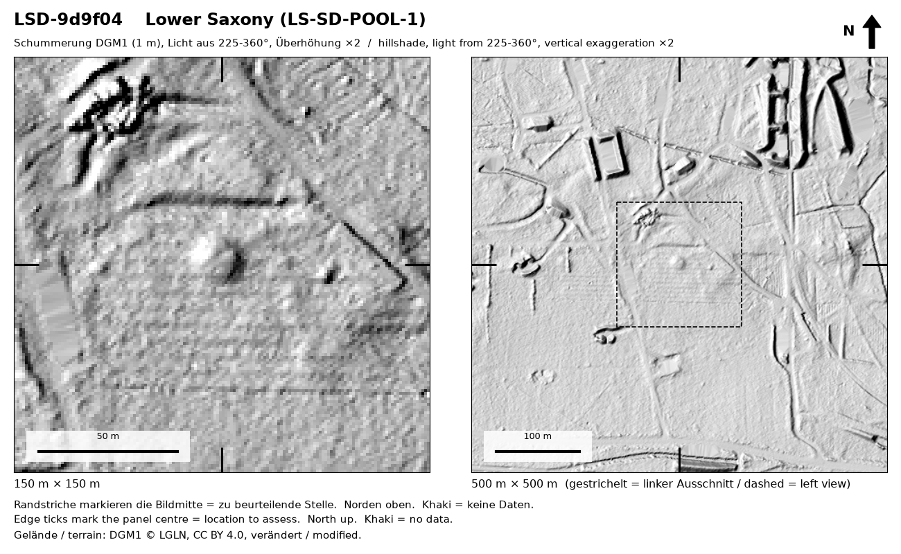

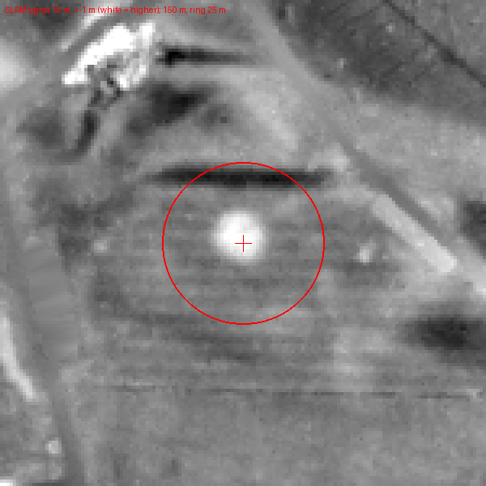

**Orthophotos (LGLN DOP20), every year available**, used to rule out modern heaps, buildings and earthworks:

| 2014-07-04 | 2016-04-02 | 2018-05-08 | 2021-03-31 | 2024-05-08 | 2024-05-08 |
|---|---|---|---|---|---|
| 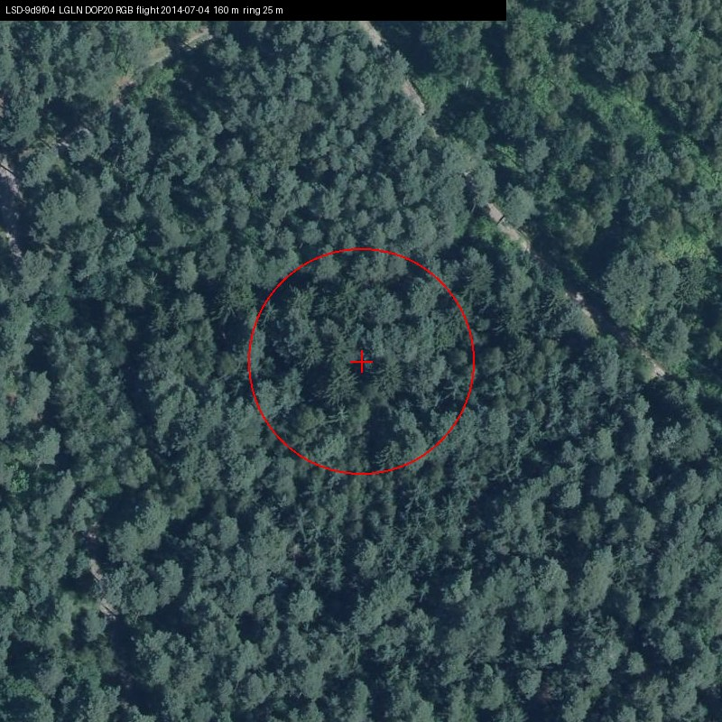 | 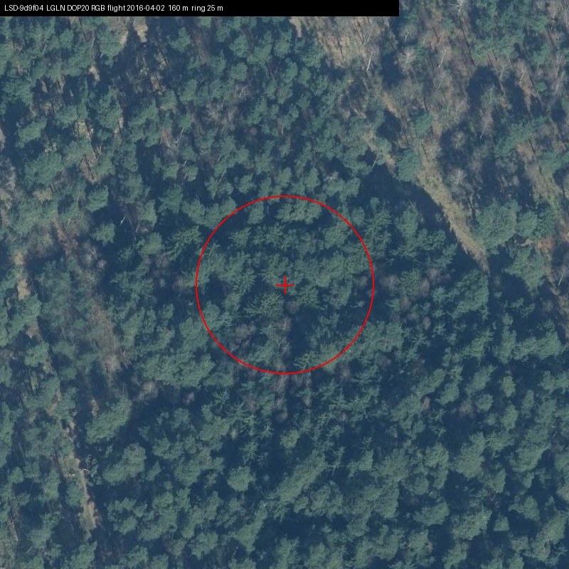 | 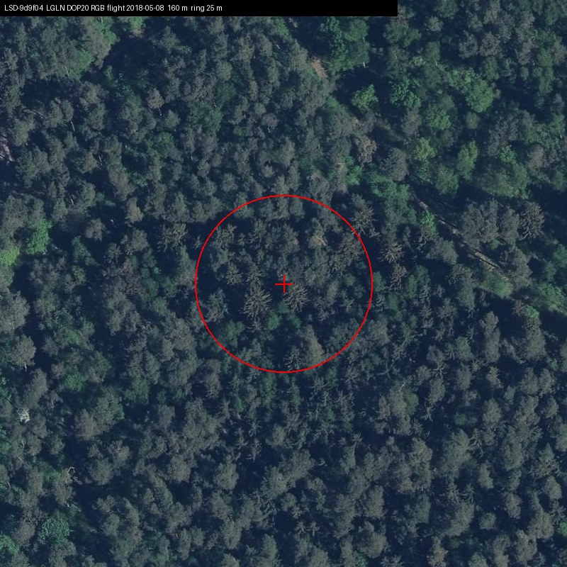 | 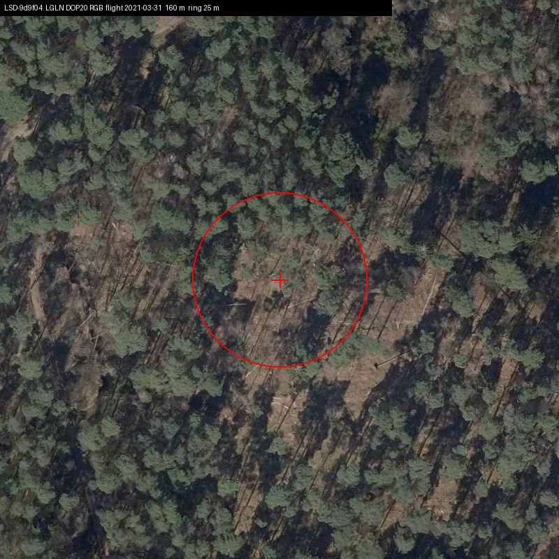 | 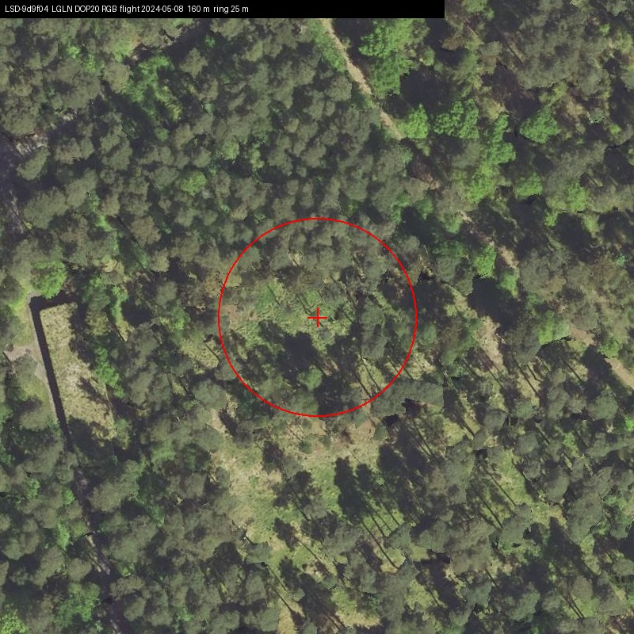 | 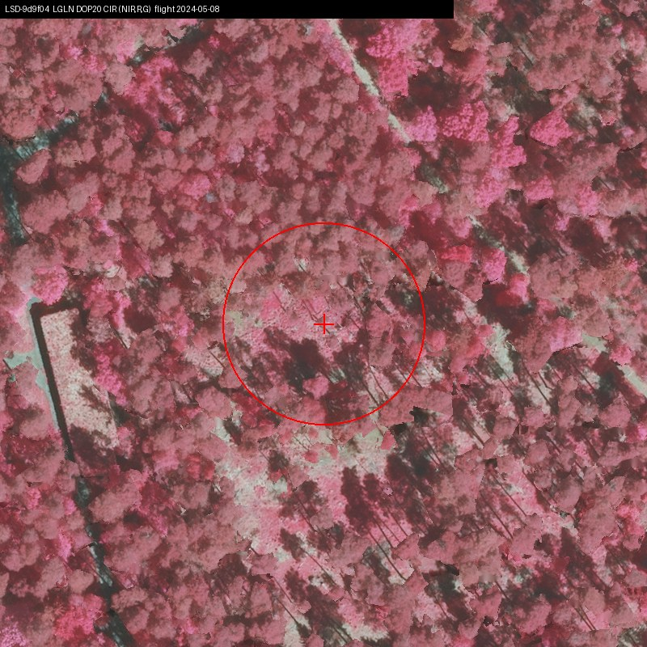 |

**Historic map.** First-edition Messtischblatt (1899), checked for a mapped structure, pit or building at the point:

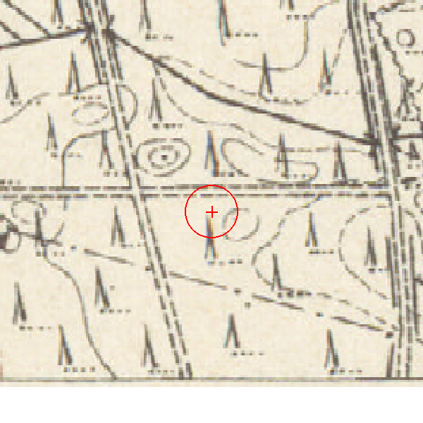

**The model reader's review before submission** (verbatim extracts from [`reader_review.json`](evidence/reader_review.json)):

> A discrete, round, dome-shaped mound about 11 m across and about 1 m high, isolated on flat ground in pine forest.

Open alternative it asked the archaeologist to weigh: *Is this mound connected with the twentieth-century rectangular earthworks and structures nearby (spoil, a blast or cover mound), or a small natural rise of the kind the 1899 form lines suggest, rather than a burial mound?*

Most likely non-archaeological explanation it considered: `MODERN-OTHER` (OPEN-WEAK); verdict `SENDABLE`.

**Detector output** ([`detection.json`](evidence/detection.json)): model `D_202`; mean probability 0.952; area 355 m², roundness 0.94; nearest registered burial mound 569 m away in the public register snapshot.

**What the authority received** (one sheet per location, coordinate line removed):

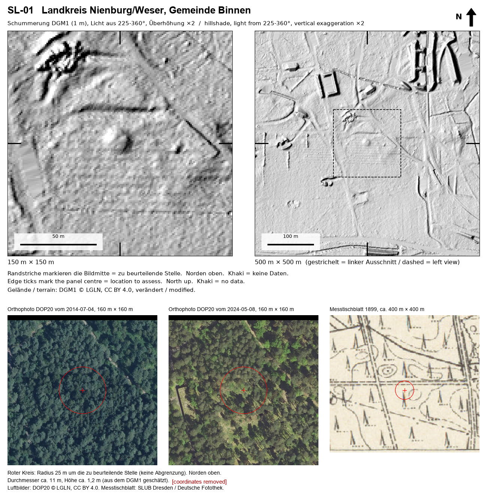

## What the assessment does and does not establish

Assessed as previously completely unknown; site number issued 3 Nov 2026. Publication in the Fundchronik promised, not yet seen. No field visit or excavation reported.

## The batch it came from

Schaumburger Landschaft, two batches totalling 11 places, all blank on the public Denkmalatlas: 1 previously unknown (D04), 2 reported before but without a site number (now Hameln FStNr. 254 and 255: R14, R15), 6 already known, 2 awaiting a field check.

## How to check this yourself

1. Ask the assessing authority, named above, about the label in the submission (`SL-01`), or the site number
   and the date of its assessment. Its contact details are on its public website.
2. Look at the terrain yourself: the hillshade above is made from public LGLN DGM1 data, which anyone can download.
3. The coordinate commitment is the SHA-256 of a string containing this ID, the exact submitted ETRS89/UTM32N
   coordinates and a random salt. The exact coordinates are withheld to protect the site (see the
   [README](../../README.md#why-exact-coordinates-are-not-published)). When they are released, to a researcher or
   publicly, the string can be published and checked against this hash, proving which point was submitted on which
   date.
