# P01: Probable burial mound, Lingen-Bramsche, Stadt Lingen (Ems)

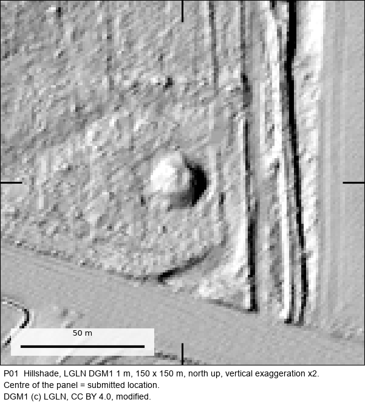

| | |
|---|---|
| Status | **Probable, field-inspected, not yet confirmed** |
| Location | Lingen-Bramsche, Stadt Lingen (Ems), Lower Saxony (municipality level; exact coordinates withheld, see below) |
| Feature | Probable burial mound, inspected on the ground |
| Assessed by | **Dr Dieter Lammers, Stadtarchäologe (city archaeologist)**, Stadtarchäologie Lingen (city archaeology service) |
| Written assessment | 2026-11-09 |
| Label in the submission | `LI-02` |
| Official record | listing intended, not yet confirmed |
| Detector | S_D + PROX |
| Terrain | LGLN DGM1, 1 m (CC BY 4.0) |
| Coordinate commitment (SHA-256) | `263b14ee4faa24b0349d0c3d25f0e3e679582abc5b0282b46c18a42c66c130ca` |

## How it was found

Proposed by S_D + PROX. The location was screened against the public Denkmalatlas Niedersachsen and reviewed by language-model readers
before it was submitted. The project owner then sent it to the responsible archaeologist with coordinates and LiDAR
views.

## Field visit

Dr Lammers visited the mound in the week before 9 November 2026 and sent this photograph with his reply (camera
timestamp 3 November 2026). It is shown downsized, with all file metadata removed.

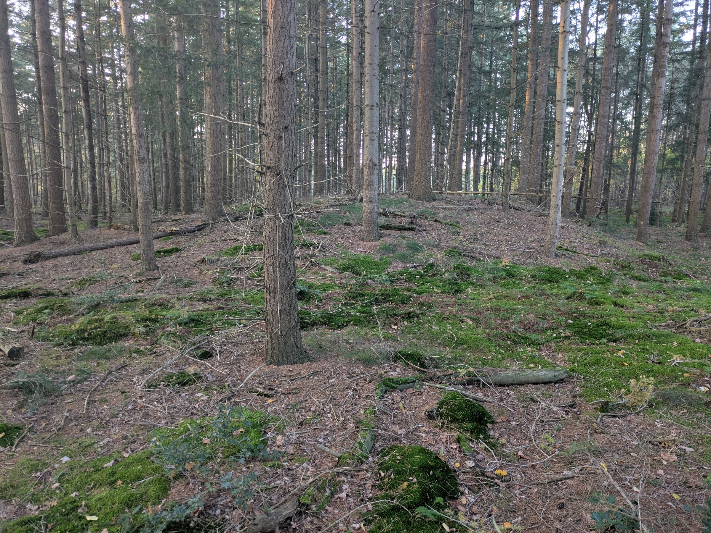

*Photo: Dr Dieter Lammers, Stadtarchäologie Lingen (Ems). Reproduced as evidence of his assessment; not covered by
this repository's CC BY licence.*

The reply as it arrived in Gmail, with the photo as its second attachment:

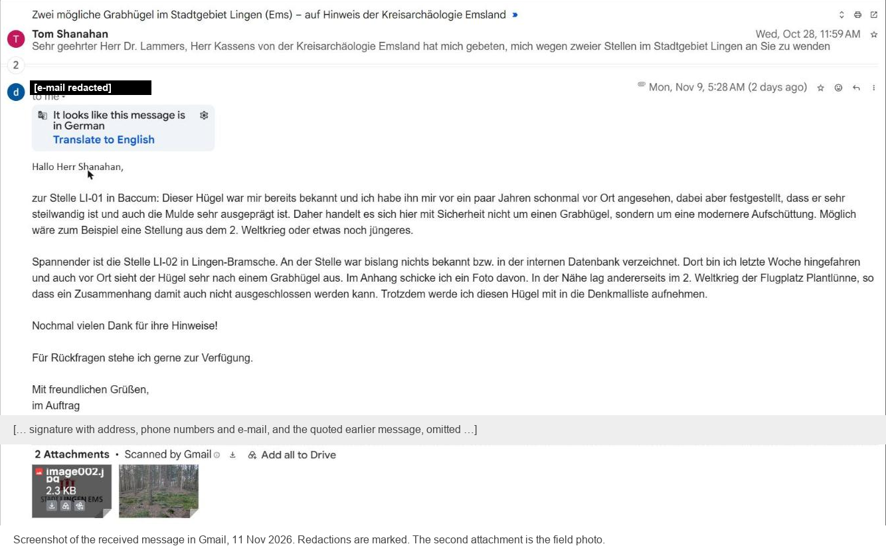

## The assessment, verbatim

The archaeologist's reply, as received. Contact details and the quoted earlier message are removed; `[…]` marks other
omissions and `[Fundstelle entfernt]` marks the names and numbers of already known sites, which are not ours to publish.

> Hallo Herr Shanahan,
>
> zur Stelle LI-01 in Baccum: Dieser Hügel war mir bereits bekannt und ich habe ihn mir vor ein paar Jahren schonmal vor Ort angesehen, dabei aber festgestellt, dass er sehr steilwandig ist und auch die Mulde sehr ausgeprägt ist. Daher handelt es sich hier mit Sicherheit nicht um einen Grabhügel, sondern um eine modernere Aufschüttung. Möglich wäre zum Beispiel eine Stellung aus dem 2. Weltkrieg oder etwas noch jüngeres.
>
> Spannender ist die Stelle LI-02 in Lingen-Bramsche. An der Stelle war bislang nichts bekannt bzw. in der internen Datenbank verzeichnet. Dort bin ich letzte Woche hingefahren und auch vor Ort sieht der Hügel sehr nach einem Grabhügel aus. Im Anhang schicke ich ein Foto davon. In der Nähe lag andererseits im 2. Weltkrieg der Flugplatz Plantlünne, so dass ein Zusammenhang damit auch nicht ausgeschlossen werden kann. Trotzdem werde ich diesen Hügel mit in die Denkmalliste aufnehmen.
>
> Nochmal vielen Dank für ihre Hinweise!
> […]
> Dr. Dieter Lammers
> -Stadtarchäologe-

**English translation (ours):**

> LI-01: already known to me; I looked at it on site a few years ago. It is very steep-sided with a very pronounced
> hollow, so it is certainly not a burial mound but a more modern dump, for example a Second World War position or
> something younger. **LI-02 in Lingen-Bramsche is more exciting. Nothing was known at this spot or recorded in the
> internal database. I drove there last week, and on site the mound also looks very much like a burial mound.** I
> attach a photo. On the other hand, the Plantlünne airfield lay nearby in the Second World War, so a connection with
> it cannot be ruled out. **I will nevertheless add this mound to the monument list.**

## Everything we looked at

The full internal evidence card is in [`evidence/`](evidence/) ([file list](evidence/README.md)): every image and
record the project used to decide whether to submit this location, plus what was sent to the authority.
Coordinates are removed; nothing else is edited.

**LiDAR terrain (LGLN DGM1, 1 m).** Hillshade at 150 m and 500 m, and a local relief model:

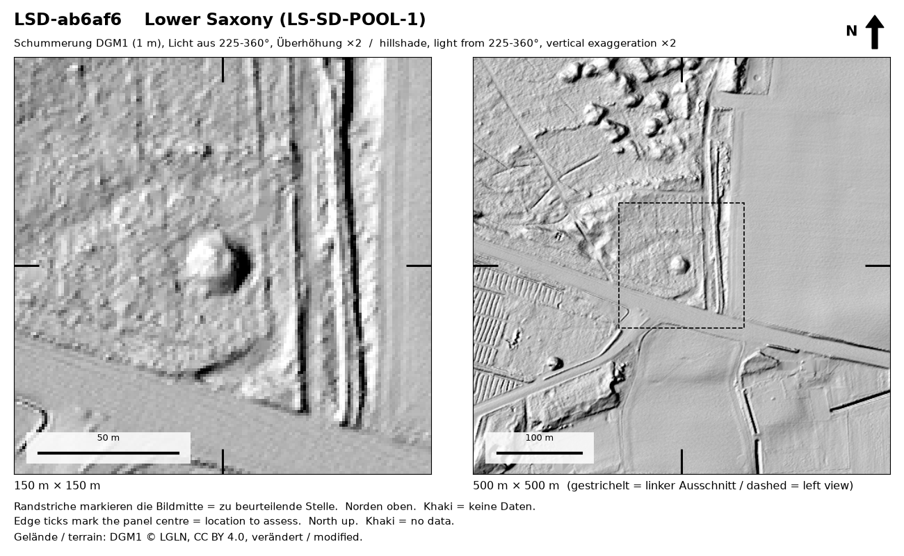

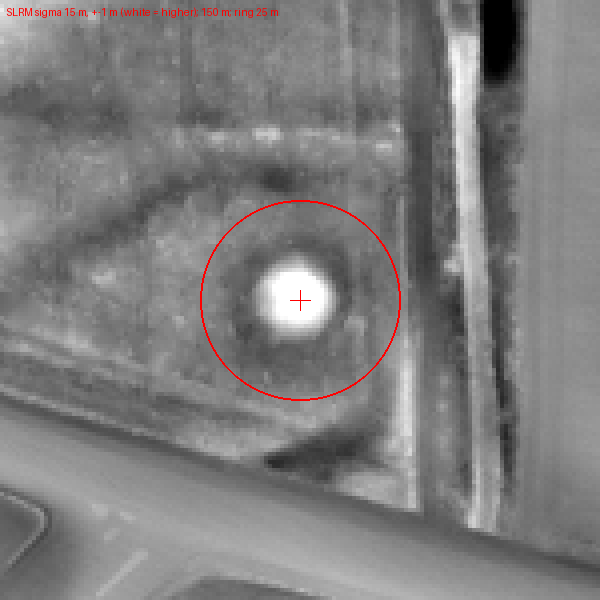

**Orthophotos (LGLN DOP20), every year available**, used to rule out modern heaps, buildings and earthworks:

| 2014-03-20 | 2017-03-25 | 2020-03-28 | 2023-04-05 | 2025-04-27 | 2025-04-27 |
|---|---|---|---|---|---|
| 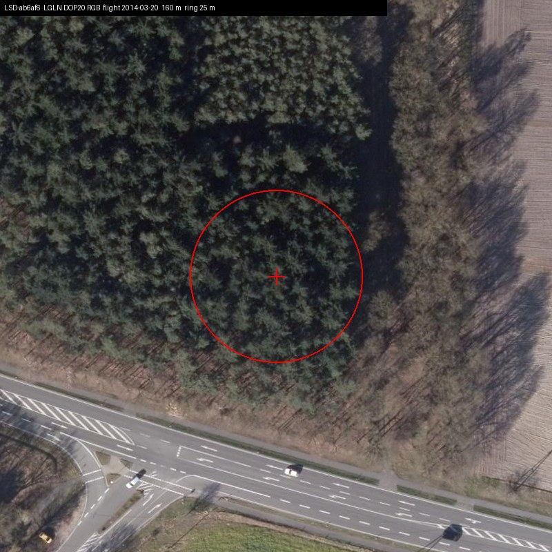 | 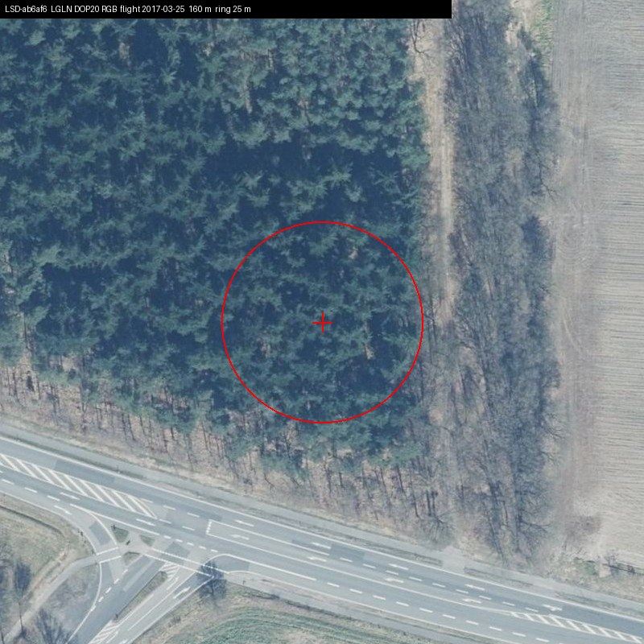 | 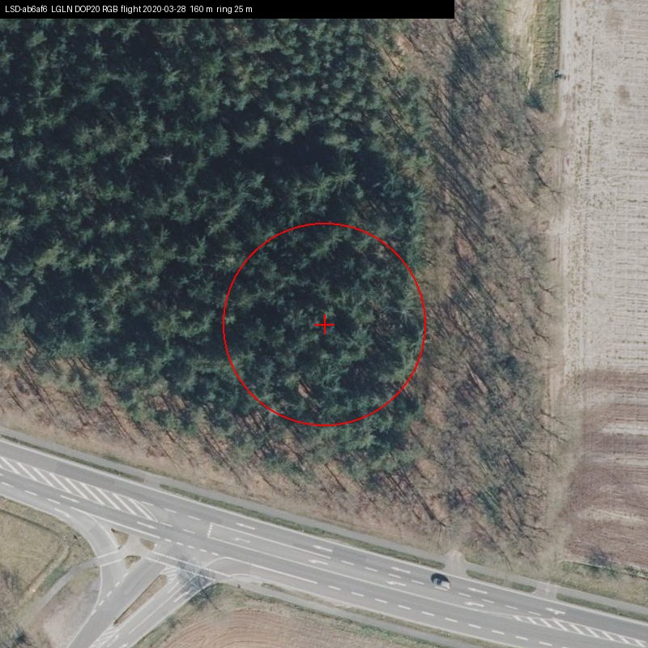 | 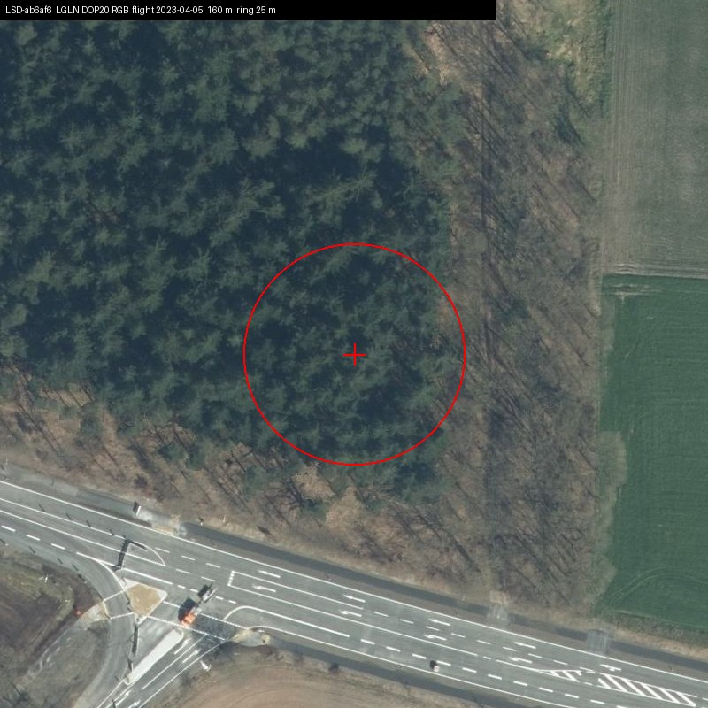 | 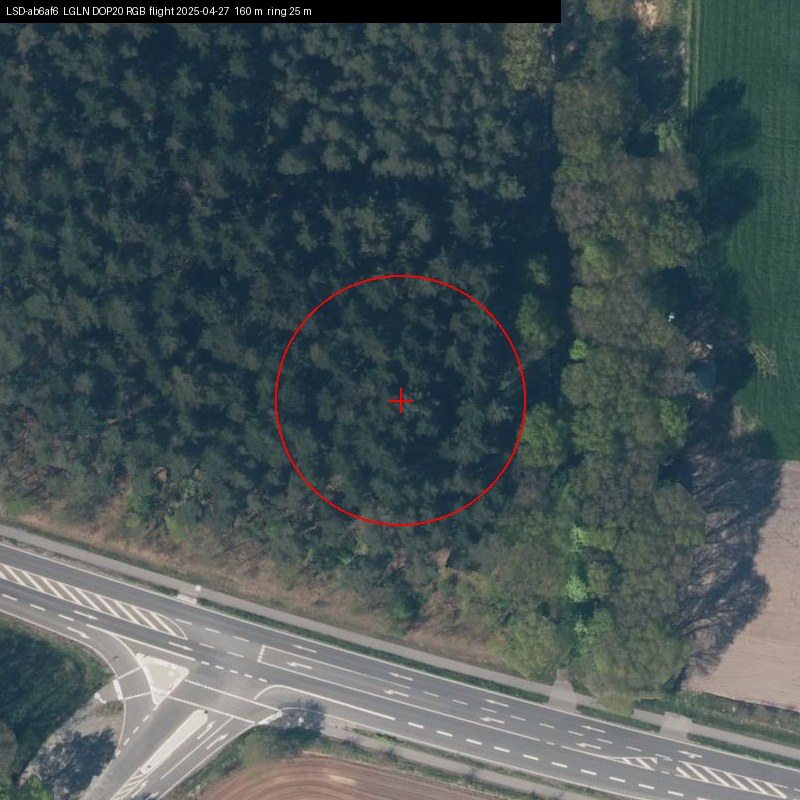 | 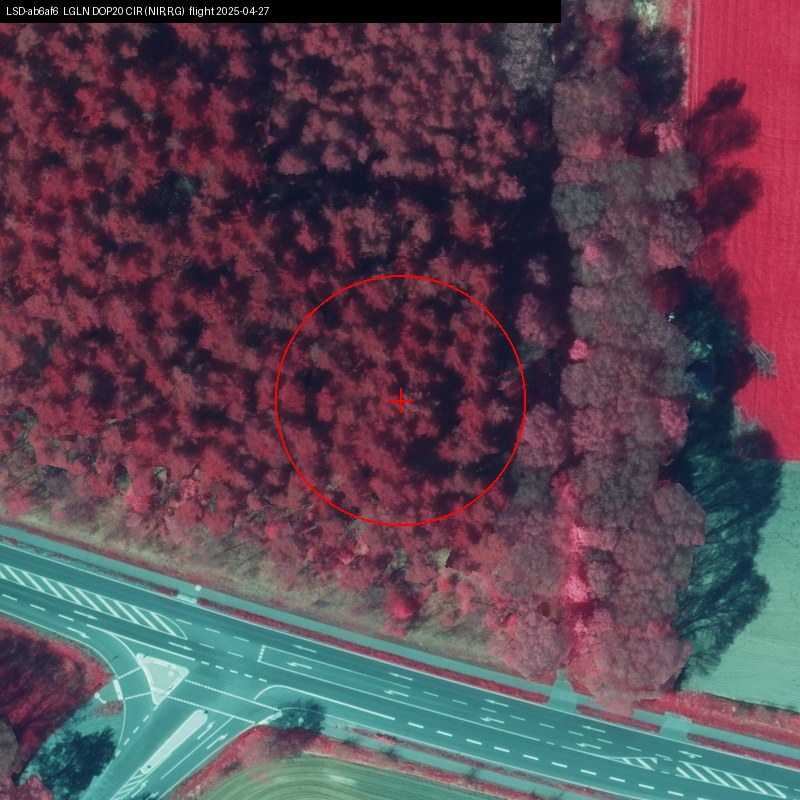 |

**Historic map.** First-edition Messtischblatt (1897), checked for a mapped structure, pit or building at the point:

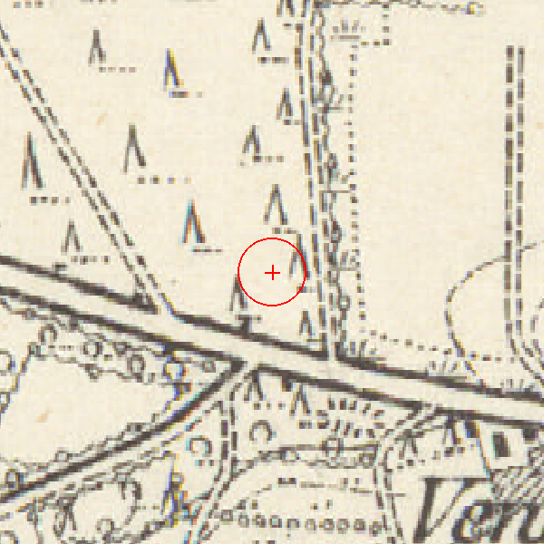

**The model reader's review before submission** (verbatim extracts from [`reader_review.json`](evidence/reader_review.json)):

> A smooth, round, steep-sided mound about 15 m across and about 1.5 m high in a conifer strip close to a main road junction, with a faint lower ring around it in the local relief model. Woodland on the 1897 Messtischblatt.

Open alternative it asked the archaeologist to weigh: *Could this be a spoil heap from road or ditch construction next to the junction, or a natural sand hummock, rather than a burial mound?*

Most likely non-archaeological explanation it considered: `QUARRY-SPOIL` (OPEN-WEAK); verdict `SENDABLE`.

**Detector output** ([`detection.json`](evidence/detection.json)): model `D_101`; mean probability 0.950; area 387 m², roundness 0.95; nearest registered burial mound 4747 m away in the public register snapshot.

**What the authority received** (one sheet per location, coordinate line removed):

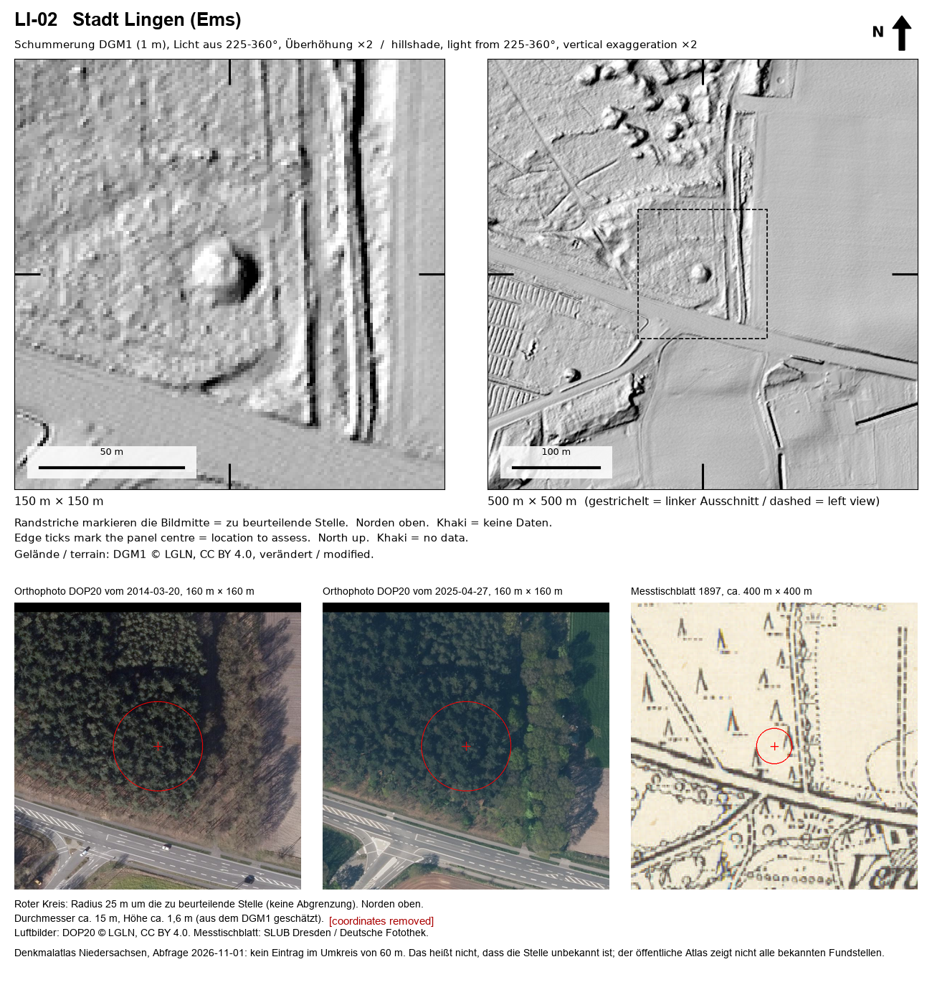

## What the assessment does and does not establish

The city archaeologist visited it and found it strongly barrow-like, and explicitly leaves a Second World War origin open. Not counted as confirmed.

## The batch it came from

Lingen batch of 2 locations: 1 probable burial mound (P01), 1 rejected as a modern earthwork.

## How to check this yourself

1. Ask the assessing authority, named above, about the label in the submission (`LI-02`)
   and the date of its assessment. Its contact details are on its public website.
2. Look at the terrain yourself: the hillshade above is made from public LGLN DGM1 data, which anyone can download.
3. The coordinate commitment is the SHA-256 of a string containing this ID, the exact submitted ETRS89/UTM32N
   coordinates and a random salt. The exact coordinates are withheld to protect the site (see the
   [README](../../README.md#why-exact-coordinates-are-not-published)). When they are released, to a researcher or
   publicly, the string can be published and checked against this hash, proving which point was submitted on which
   date.
