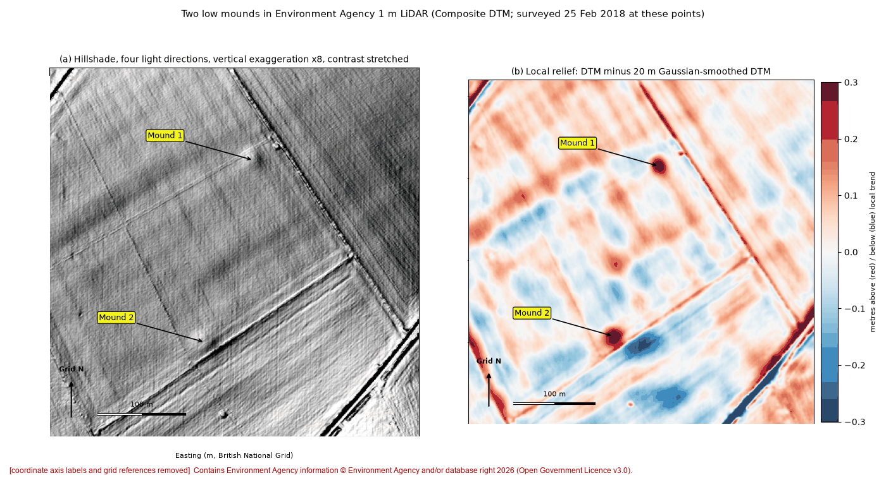
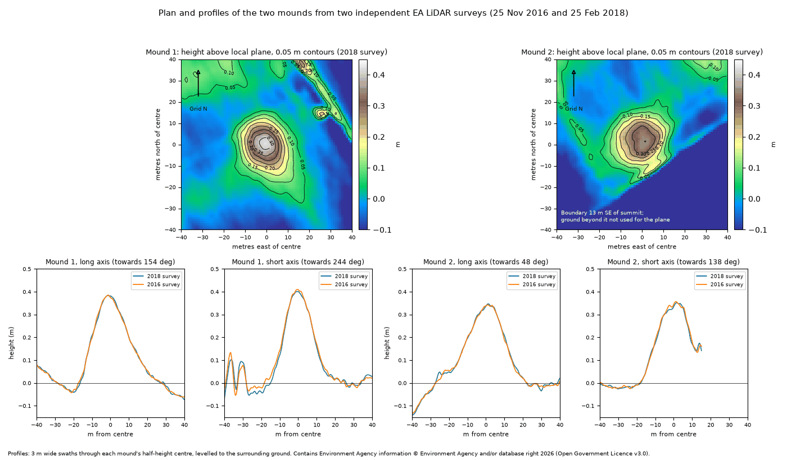

# O01: Undated mound, Wiltshire, England

| | |
|---|---|
| Status | Other documented positive outcome (record absence confirmed, research list, offered addition, comment) |
| Assessed by | Charlotte Godsiffe, HER officer, Wiltshire and Swindon Historic Environment Record |
| Assessment date | 2026-10-02 |
| Official record | - |
| Detector | CONT e41 |
| Limitations | Absent from the record; the officer offered to add it as an undated mound. Addition not yet confirmed. |

## Everything we looked at

What the authority was sent and the internal research behind it. Coordinates, grid references, coordinate
query links and internal file paths are removed from every file; nothing else is edited.

| File | Content | Source / licence |
|---|---|---|
| [`submitted_Fig1_LiDAR_hillshade_and_local_relief.png`](evidence/submitted_Fig1_LiDAR_hillshade_and_local_relief.png) | Image sent to the authority with the enquiry (coordinates removed) | ours; terrain from Environment Agency LiDAR (OGL v3.0) or IGN LiDAR HD (Licence Ouverte 2.0) |
| [`submitted_Fig2_LiDAR_plans_and_profiles.png`](evidence/submitted_Fig2_LiDAR_plans_and_profiles.png) | Image sent to the authority with the enquiry (coordinates removed) | ours; terrain from Environment Agency LiDAR (OGL v3.0) or IGN LiDAR HD (Licence Ouverte 2.0) |
| [`internal_dossier.md`](evidence/internal_dossier.md) | Internal research dossier: terrain, imagery, maps, records and alternative explanations checked | ours |
| [`internal_challenge.md`](evidence/internal_challenge.md) | Internal adversarial challenge of the dossier | ours |

**Not included:** 66 further files from the internal dossier: scans of third-party documents and
maps whose reuse terms do not allow republication (archive cadastre scans, published book and journal pages, Esri
and NLS imagery), and working images marked private because they show coordinates.
