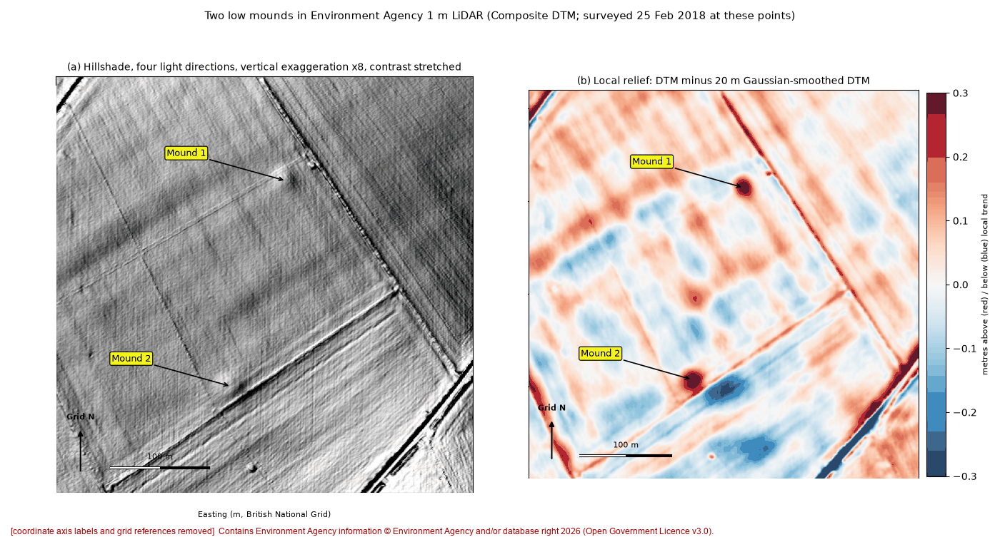
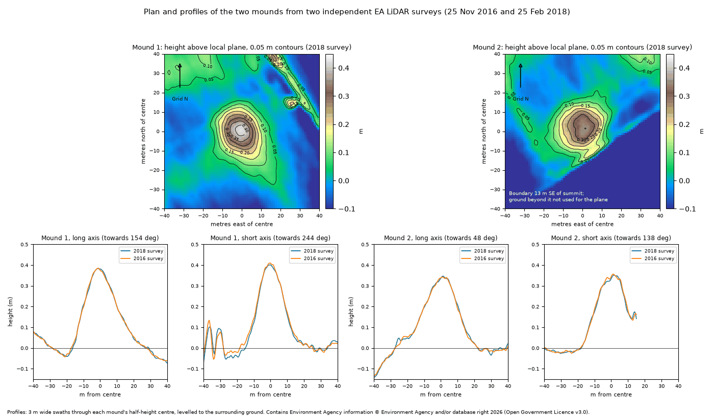

# O02: Second undated mound, Wiltshire, England

| | |
|---|---|
| Status | Other documented positive outcome (record absence confirmed, research list, offered addition, comment) |
| Assessed by | Charlotte Godsiffe, HER officer, Wiltshire and Swindon Historic Environment Record |
| Assessment date | 2026-10-02 |
| Official record | - |
| Detector | pointed out by the officer (also present in CONT e41 output, found afterwards) |
| Limitations | As O01. Listed for completeness; it is the officer's observation, not ours. |

## Everything we looked at

What the authority was sent and the internal research behind it. Coordinates, grid references, coordinate
query links and internal file paths are removed from every file; nothing else is edited.

| File | Content | Source / licence |
|---|---|---|
| [`submitted_Fig1_LiDAR_hillshade_and_local_relief.png`](evidence/submitted_Fig1_LiDAR_hillshade_and_local_relief.png) | Image sent to the authority with the enquiry (coordinates removed) | ours; terrain from Environment Agency LiDAR (OGL v3.0) or IGN LiDAR HD (Licence Ouverte 2.0) |
| [`submitted_Fig2_LiDAR_plans_and_profiles.png`](evidence/submitted_Fig2_LiDAR_plans_and_profiles.png) | Image sent to the authority with the enquiry (coordinates removed) | ours; terrain from Environment Agency LiDAR (OGL v3.0) or IGN LiDAR HD (Licence Ouverte 2.0) |
| [`internal_review_panel.png`](evidence/internal_review_panel.png) | Internal screening panel (hillshade and local relief) | ours; Environment Agency LiDAR, OGL v3.0 |
