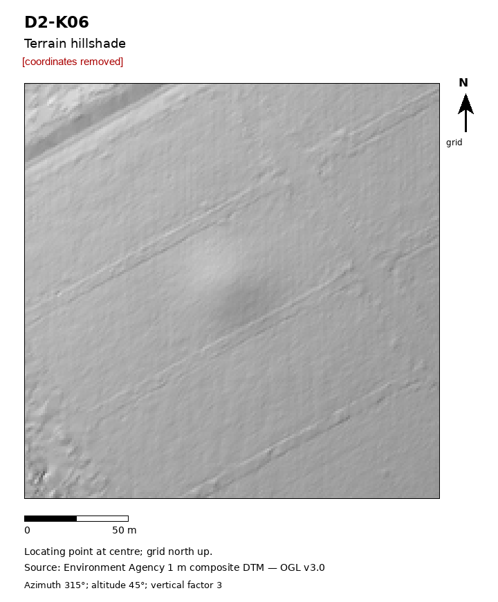

# O03: Low round rise in a grass paddock, Norfolk, England

| | |
|---|---|
| Status | Other documented positive outcome (record absence confirmed, research list, offered addition, comment) |
| Assessed by | Hannah Henderson, Assistant HER Officer, Norfolk Historic Environment Record |
| Assessment date | 2026-10-08 |
| Official record | - |
| Detector | CONT e41 |
| Limitations | Officer confirmed no existing record. A natural knoll or later dumping remain possible. |

## Everything we looked at

What the authority was sent and the internal research behind it. Coordinates, grid references, coordinate
query links and internal file paths are removed from every file; nothing else is edited.

| File | Content | Source / licence |
|---|---|---|
| [`submitted_hillshade.png`](evidence/submitted_hillshade.png) | Image sent to the authority with the enquiry (coordinates removed) | ours; terrain from Environment Agency LiDAR (OGL v3.0) or IGN LiDAR HD (Licence Ouverte 2.0) |
