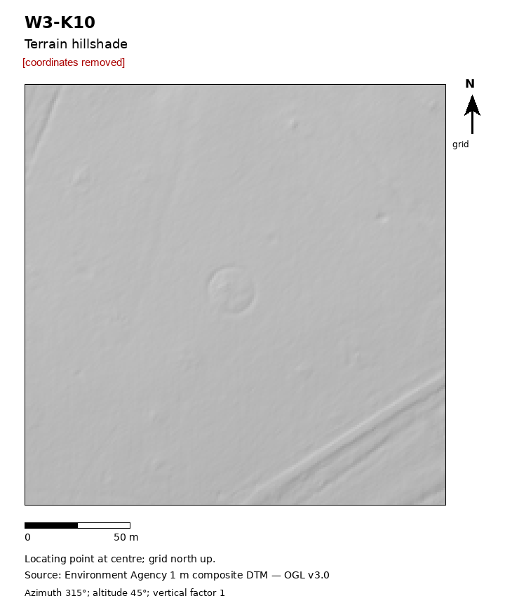

# O05: Circular parkland tree coppice, Essex, England

| | |
|---|---|
| Status | Other documented positive outcome (record absence confirmed, research list, offered addition, comment) |
| Assessed by | Abigail Milsom, with an aerial interpretation colleague, Essex Historic Environment Record (Place Services) |
| Assessment date | 2026-10-13 |
| Official record | comment added to an existing record |
| Detector | CONT e41 |
| Limitations | Shown on the first-edition OS map; not a new monument. |

## Everything we looked at

What the authority was sent and the internal research behind it. Coordinates, grid references, coordinate
query links and internal file paths are removed from every file; nothing else is edited.

| File | Content | Source / licence |
|---|---|---|
| [`submitted_hillshade.png`](evidence/submitted_hillshade.png) | Image sent to the authority with the enquiry (coordinates removed) | ours; terrain from Environment Agency LiDAR (OGL v3.0) or IGN LiDAR HD (Licence Ouverte 2.0) |
