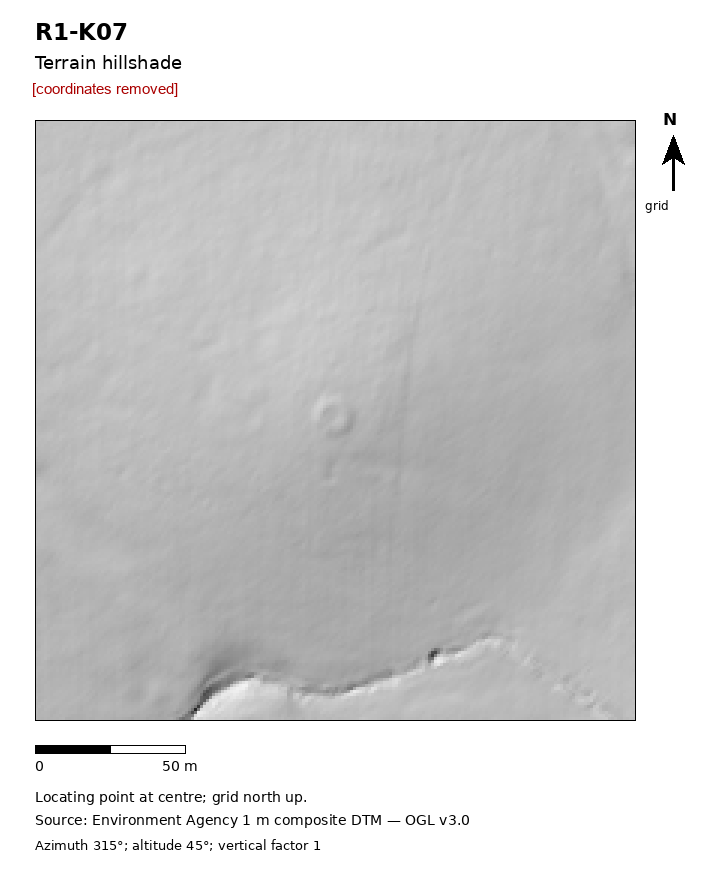

# R05: Probable round barrow, apparently dug into in the past, Somerset, England

| | |
|---|---|
| Status | Added to an official heritage record (not a confirmed new archaeological site) |
| Assessed by | Chris Webster, HER officer, Somerset Historic Environment Record (South West Heritage Trust) |
| Assessment date | 2026-10-06 |
| Official record | 58699 |
| Detector | CONT e41 |
| Limitations | Recorded with a probable-barrow interpretation and the discovery credited to the submitter. The officer noted the form is unusually neat; on 22 Oct 2026 he said he is uncertain of an archaeological origin and would ask colleagues. Not counted as confirmed. |

## Everything we looked at

What the authority was sent and the internal research behind it. Coordinates, grid references, coordinate
query links and internal file paths are removed from every file; nothing else is edited.

| File | Content | Source / licence |
|---|---|---|
| [`submitted_hillshade.png`](evidence/submitted_hillshade.png) | Image sent to the authority with the enquiry (coordinates removed) | ours; terrain from Environment Agency LiDAR (OGL v3.0) or IGN LiDAR HD (Licence Ouverte 2.0) |
| [`internal_dossier.md`](evidence/internal_dossier.md) | Internal research dossier: terrain, imagery, maps, records and alternative explanations checked | ours |
| [`internal_challenge.md`](evidence/internal_challenge.md) | Internal adversarial challenge of the dossier | ours |

**Not included:** 1 further files from the internal dossier: scans of third-party documents and
maps whose reuse terms do not allow republication (archive cadastre scans, published book and journal pages, Esri
and NLS imagery), and working images marked private because they show coordinates.
