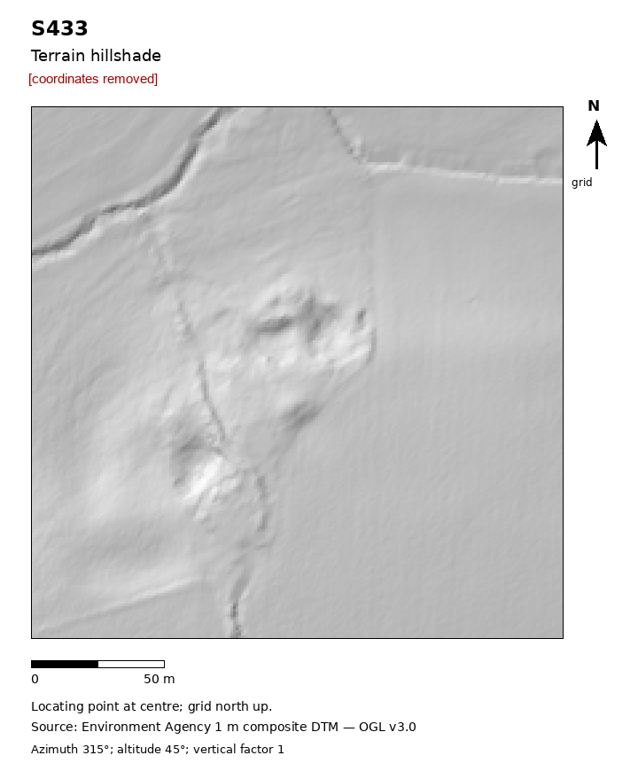
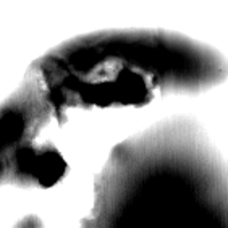
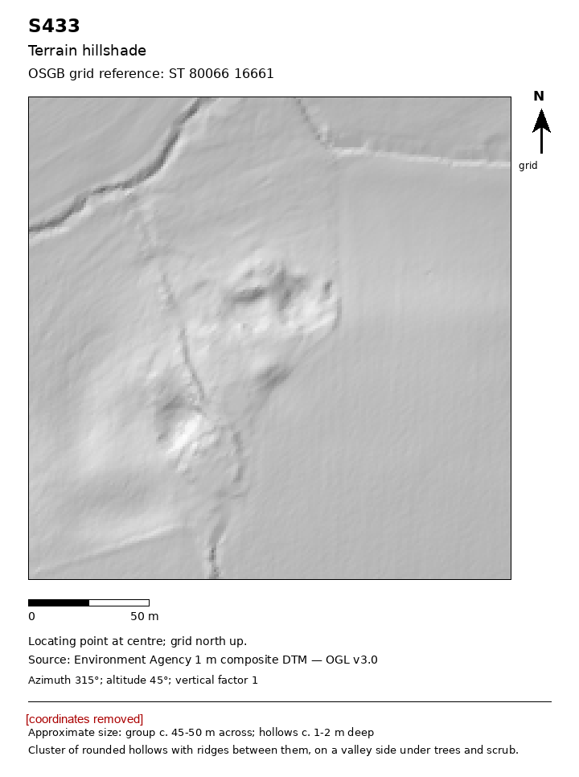

# R06: Cluster of hollows: probable post-medieval quarrying, Dorset, England

| | |
|---|---|
| Status | Added to an official heritage record (not a confirmed new archaeological site) |
| Assessed by | Claire Pinder, Senior Archaeologist, Dorset Historic Environment Record (Dorset Council) |
| Assessment date | 2026-10-13 |
| Official record | MDO51320 |
| Detector | CONT e41 |
| Limitations | Post-medieval quarrying, not an ancient site. |

## Everything we looked at

What the authority was sent and the internal research behind it. Coordinates, grid references, coordinate
query links and internal file paths are removed from every file; nothing else is edited.

| File | Content | Source / licence |
|---|---|---|
| [`submitted_hillshade.png`](evidence/submitted_hillshade.png) | Image sent to the authority with the enquiry (coordinates removed) | ours; terrain from Environment Agency LiDAR (OGL v3.0) or IGN LiDAR HD (Licence Ouverte 2.0) |
| [`submitted_relief.png`](evidence/submitted_relief.png) | Image sent to the authority with the enquiry (coordinates removed) | ours; terrain from Environment Agency LiDAR (OGL v3.0) or IGN LiDAR HD (Licence Ouverte 2.0) |
| [`submitted_captioned.png`](evidence/submitted_captioned.png) | Image sent to the authority with the enquiry (coordinates removed) | ours; terrain from Environment Agency LiDAR (OGL v3.0) or IGN LiDAR HD (Licence Ouverte 2.0) |
