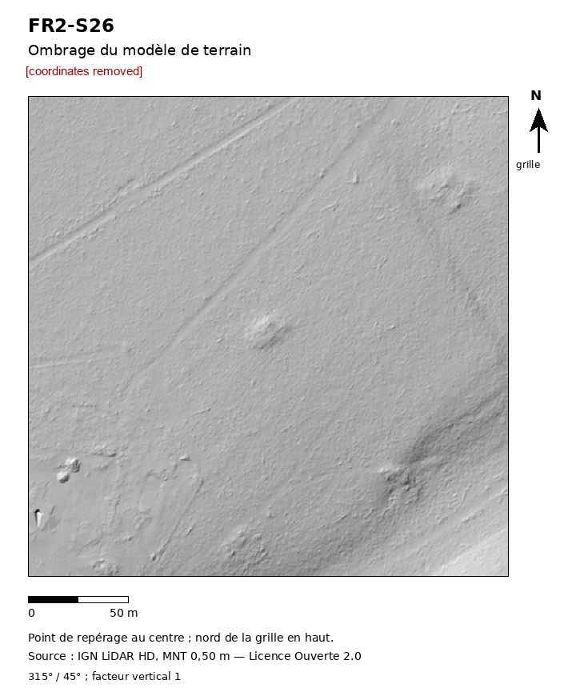
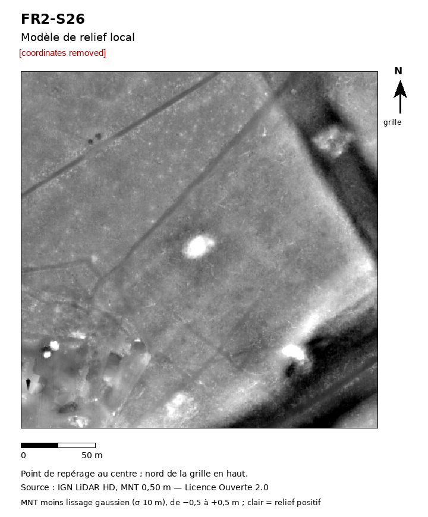

# R13: Compact mound c.25 m, c.1.2 m high, two similar mounds nearby, woodland, Nièvre, France

| | |
|---|---|
| Status | Added to an official heritage record (not a confirmed new archaeological site) |
| Assessed by | Anaïs Empereur, Service régional de l'archéologie, Service régional de l'archéologie, DRAC Bourgogne-Franche-Comté |
| Assessment date | 2026-10-27 |
| Official record | added to regional inventory (no id given) |
| Detector | CONT e41 |
| Limitations | As R07. |

## Everything we looked at

What the authority was sent and the internal research behind it. Coordinates, grid references, coordinate
query links and internal file paths are removed from every file; nothing else is edited.

| File | Content | Source / licence |
|---|---|---|
| [`submitted_hillshade.png`](evidence/submitted_hillshade.png) | Image sent to the authority with the enquiry (coordinates removed) | ours; terrain from Environment Agency LiDAR (OGL v3.0) or IGN LiDAR HD (Licence Ouverte 2.0) |
| [`submitted_relief_local.png`](evidence/submitted_relief_local.png) | Image sent to the authority with the enquiry (coordinates removed) | ours; terrain from Environment Agency LiDAR (OGL v3.0) or IGN LiDAR HD (Licence Ouverte 2.0) |
| [`internal_dossier.md`](evidence/internal_dossier.md) | Internal research dossier: terrain, imagery, maps, records and alternative explanations checked | ours |
| [`internal_dtm_building_check.png`](evidence/internal_dtm_building_check.png) | Internal dossier image: terrain measurement, profiles or triage sheet | ours; IGN LiDAR HD / Environment Agency LiDAR |
| [`internal_dtm_dtm_views.png`](evidence/internal_dtm_dtm_views.png) | Internal dossier image: terrain measurement, profiles or triage sheet | ours; IGN LiDAR HD / Environment Agency LiDAR |
| [`internal_dtm_profiles.png`](evidence/internal_dtm_profiles.png) | Internal dossier image: terrain measurement, profiles or triage sheet | ours; IGN LiDAR HD / Environment Agency LiDAR |
| [`internal_dtm_profiles_refined.png`](evidence/internal_dtm_profiles_refined.png) | Internal dossier image: terrain measurement, profiles or triage sheet | ours; IGN LiDAR HD / Environment Agency LiDAR |
| [`internal_imagery_cassini_2000.png`](evidence/internal_imagery_cassini_2000.png) | Internal dossier image: Cassini map | BnF Gallica / IGN; source reuse terms apply |
| [`internal_imagery_etatmajor_1000.png`](evidence/internal_imagery_etatmajor_1000.png) | Internal dossier image: Etat-major map (1820-66) | IGN, Licence Ouverte 2.0 |
| [`internal_imagery_imagery_sheet.png`](evidence/internal_imagery_imagery_sheet.png) | Internal dossier image: terrain measurement, profiles or triage sheet | ours; IGN LiDAR HD / Environment Agency LiDAR |
| [`internal_imagery_irc_300.jpg`](evidence/internal_imagery_irc_300.jpg) | Internal dossier image: IGN orthophoto | IGN, Licence Ouverte 2.0 |
| [`internal_imagery_maps_zoom.png`](evidence/internal_imagery_maps_zoom.png) | Internal dossier image: terrain measurement, profiles or triage sheet | ours; IGN LiDAR HD / Environment Agency LiDAR |
| [`internal_imagery_o1950_1000.png`](evidence/internal_imagery_o1950_1000.png) | Internal dossier image: IGN orthophoto | IGN, Licence Ouverte 2.0 |
| [`internal_imagery_o1950_300.png`](evidence/internal_imagery_o1950_300.png) | Internal dossier image: IGN orthophoto | IGN, Licence Ouverte 2.0 |
| [`internal_imagery_o1965_300.png`](evidence/internal_imagery_o1965_300.png) | Internal dossier image: IGN orthophoto | IGN, Licence Ouverte 2.0 |
| [`internal_imagery_o1980_300.png`](evidence/internal_imagery_o1980_300.png) | Internal dossier image: IGN orthophoto | IGN, Licence Ouverte 2.0 |
| [`internal_imagery_o2000_300.jpg`](evidence/internal_imagery_o2000_300.jpg) | Internal dossier image: IGN orthophoto | IGN, Licence Ouverte 2.0 |
| [`internal_imagery_ocur_1000.jpg`](evidence/internal_imagery_ocur_1000.jpg) | Internal dossier image: IGN orthophoto | IGN, Licence Ouverte 2.0 |
| [`internal_imagery_ocur_300.jpg`](evidence/internal_imagery_ocur_300.jpg) | Internal dossier image: IGN orthophoto | IGN, Licence Ouverte 2.0 |
| [`internal_imagery_scan50_1950_1000.png`](evidence/internal_imagery_scan50_1950_1000.png) | Internal dossier image: IGN map | IGN, Licence Ouverte 2.0 |
| [`internal_imagery_zoom100_sheet.png`](evidence/internal_imagery_zoom100_sheet.png) | Internal dossier image: terrain measurement, profiles or triage sheet | ours; IGN LiDAR HD / Environment Agency LiDAR |
| [`internal_TRIAGE_SHEET.png`](evidence/internal_TRIAGE_SHEET.png) | Internal dossier image: terrain measurement, profiles or triage sheet | ours; IGN LiDAR HD / Environment Agency LiDAR |

**Not included:** 4 further files from the internal dossier: scans of third-party documents and
maps whose reuse terms do not allow republication (archive cadastre scans, published book and journal pages, Esri
and NLS imagery), and working images marked private because they show coordinates.
