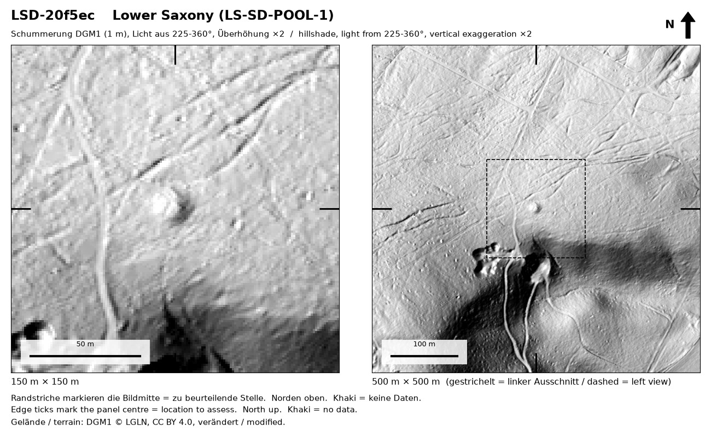
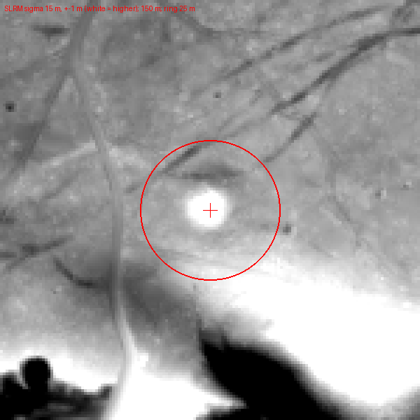
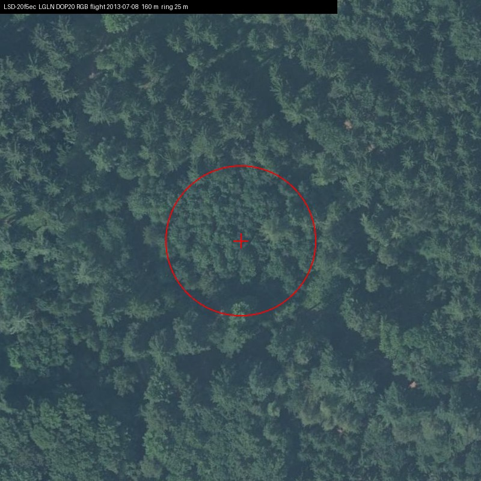
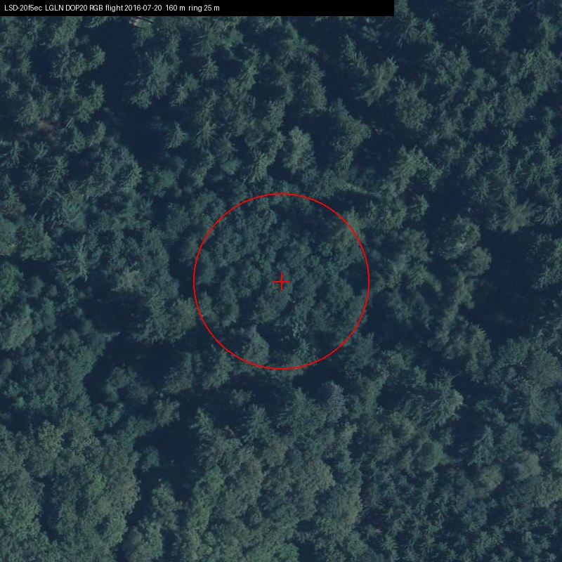
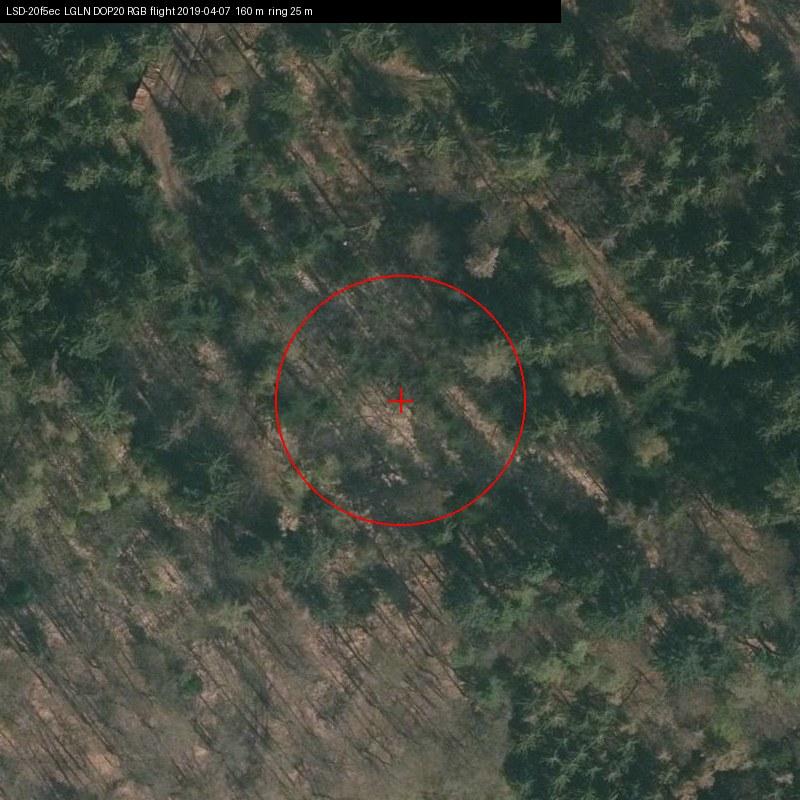
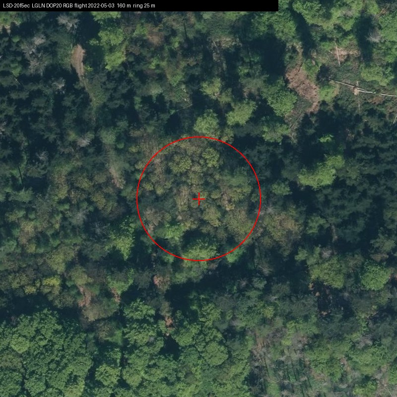
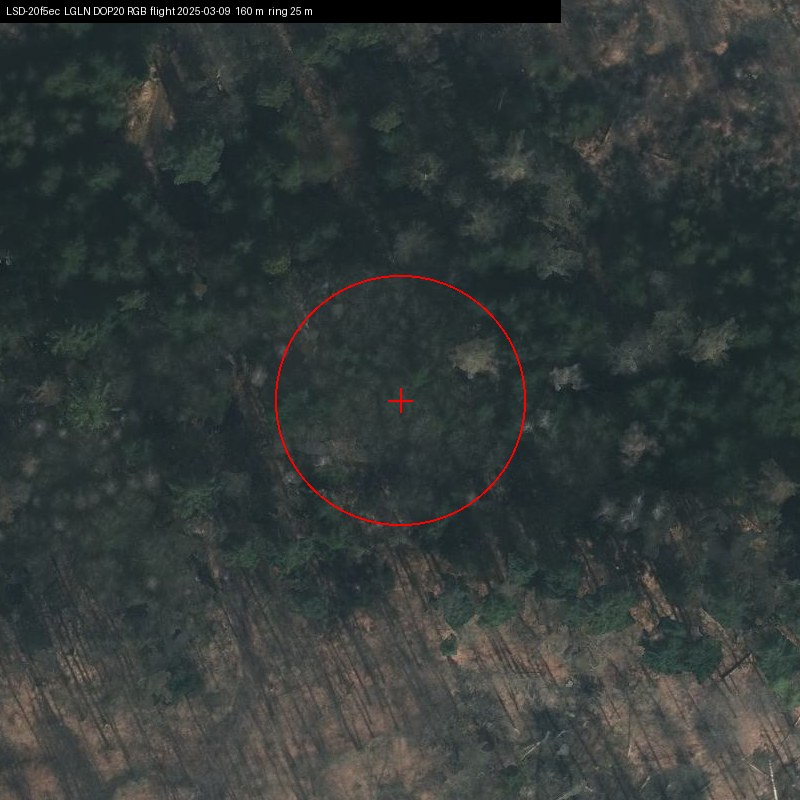
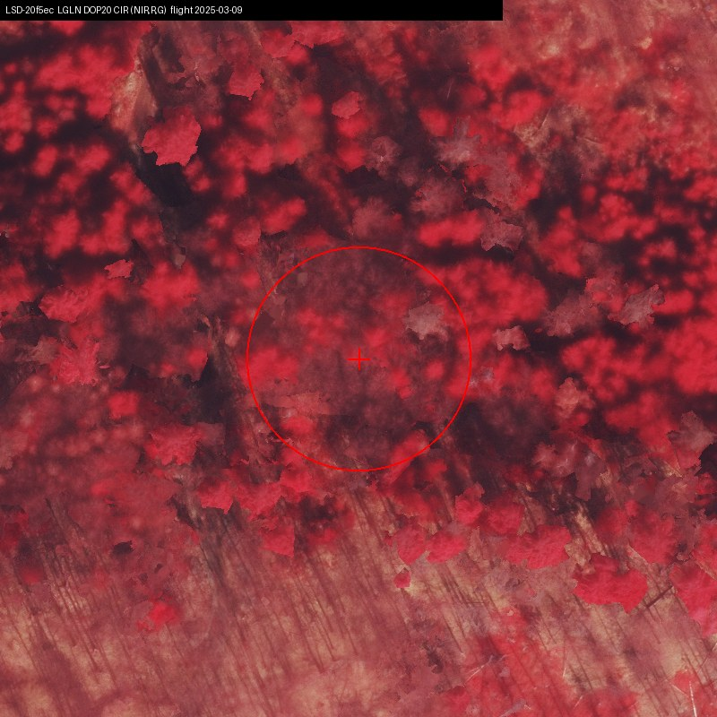
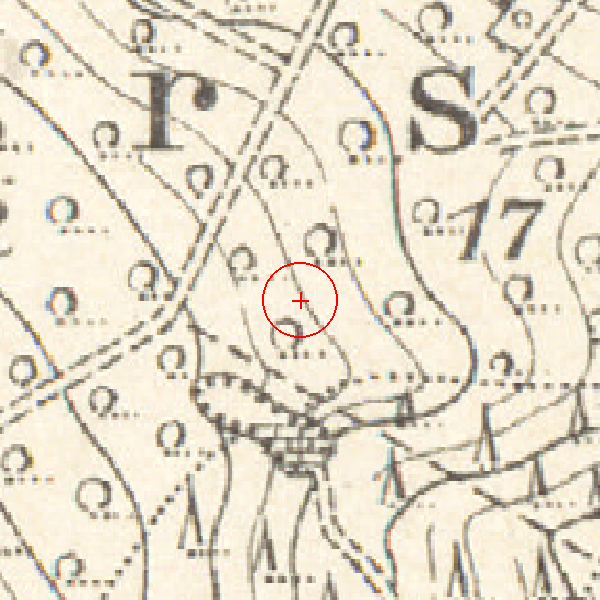
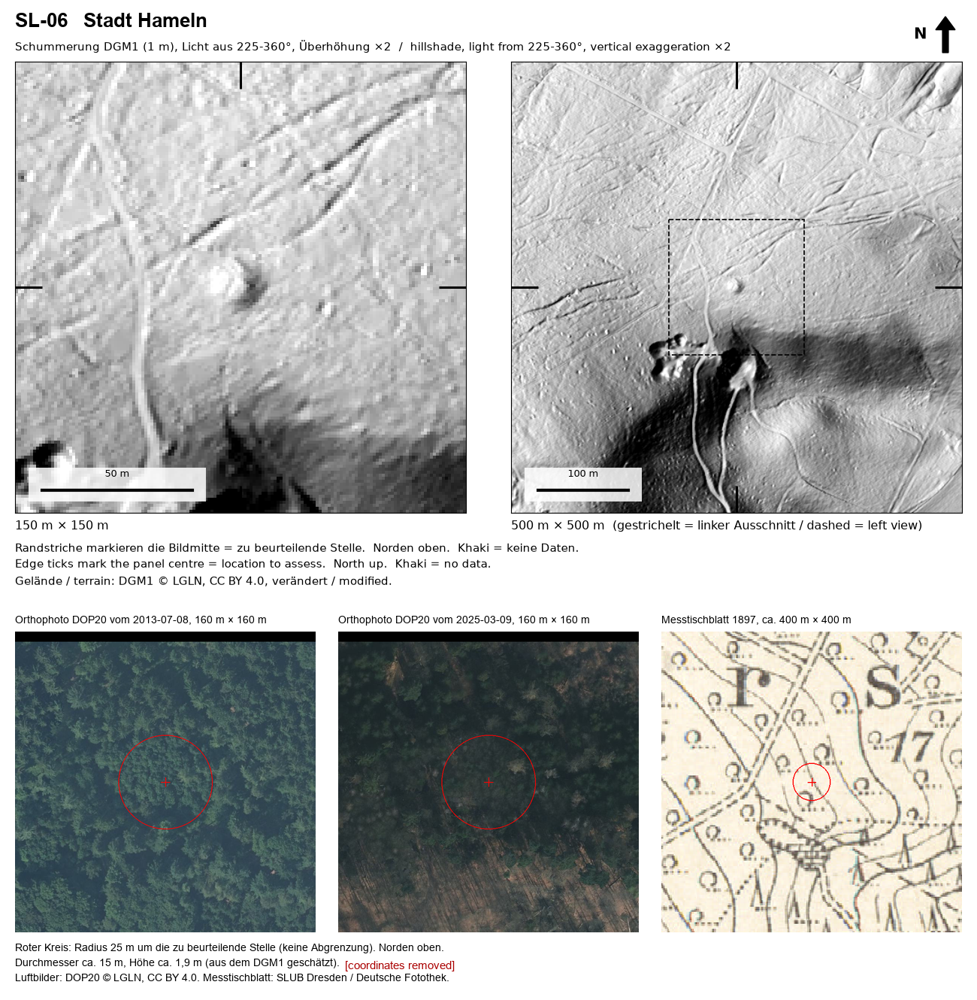

# R15: Mound reported before, now formally recorded, Stadt Hameln, Lower Saxony

| | |
|---|---|
| Status | Added to an official heritage record (not a confirmed new archaeological site) |
| Assessed by | Dr Daniel Lau, Kommunalarchäologe (municipal archaeologist), Kommunalarchäologie Schaumburger Landschaft (municipal archaeology service) |
| Assessment date | 2026-11-02 |
| Official record | Hameln FStNr. 255 |
| Label in the submission | `SL-06` |
| Detector | S_D + PROX |
| Limitations | As R14. |

The assessing archaeologist's reply is quoted on the [D04 page](../../discoveries/D04-schaumburg-burial-mound/README.md#the-assessment-verbatim), which covers the same batch.

## Everything we looked at

The full internal evidence card is in [`evidence/`](evidence/) ([file list](evidence/README.md)): every image and
record the project used to decide whether to submit this location, plus what was sent to the authority.
Coordinates are removed; nothing else is edited.

**LiDAR terrain (LGLN DGM1, 1 m).** Hillshade at 150 m and 500 m, and a local relief model:

**Orthophotos (LGLN DOP20), every year available**, used to rule out modern heaps, buildings and earthworks:

| 2013-07-08 | 2016-07-20 | 2019-04-07 | 2022-05-03 | 2025-03-09 | 2025-03-09 |
|---|---|---|---|---|---|
|  |  |  |  |  |  |

**Historic map.** First-edition Messtischblatt (1897), checked for a mapped structure, pit or building at the point:

**The model reader's review before submission** (verbatim extracts from [`reader_review.json`](evidence/reader_review.json)):

> Round dome about 15 m across with about 1.9 m local relief on a forested plateau edge, about 80 m north of a quarry already mapped in 1897.

Open alternative it asked the archaeologist to weigh: *Could this be a spoil heap from the quarry about 80 m to the south, or a natural knoll on the plateau edge?*

Most likely non-archaeological explanation it considered: `QUARRY-SPOIL` (OPEN-WEAK); verdict `SENDABLE`.

**Detector output** ([`detection.json`](evidence/detection.json)): model `D_101`; mean probability 0.958; area 448 m², roundness 0.94; nearest registered burial mound 634 m away in the public register snapshot.

**What the authority received** (one sheet per location, coordinate line removed):

